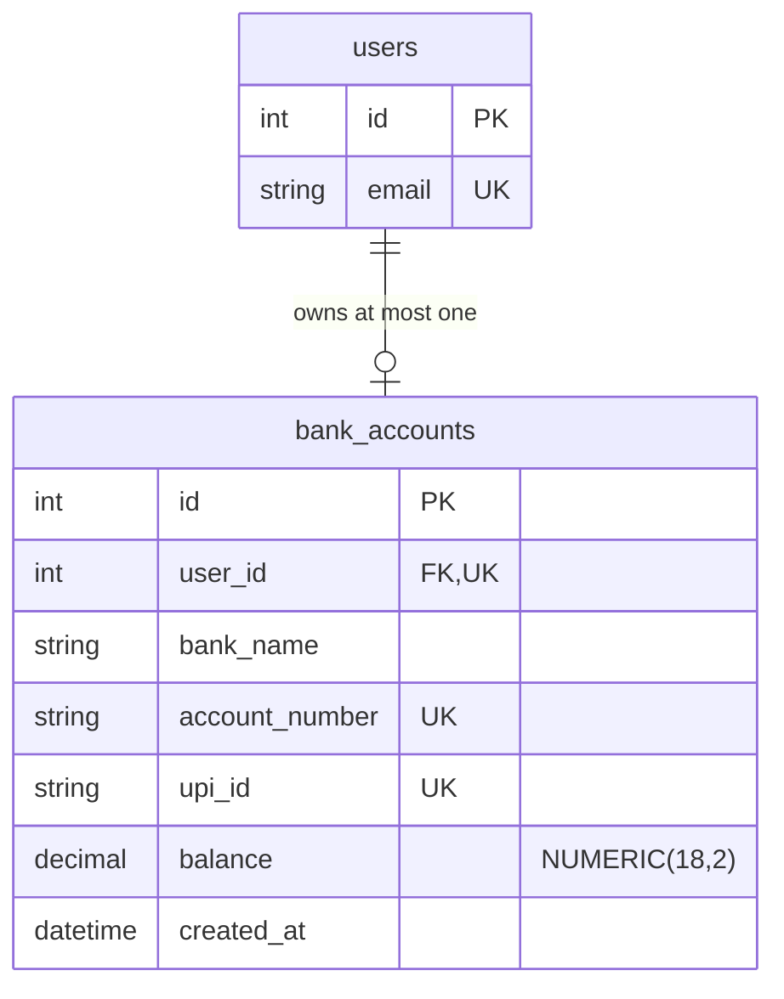
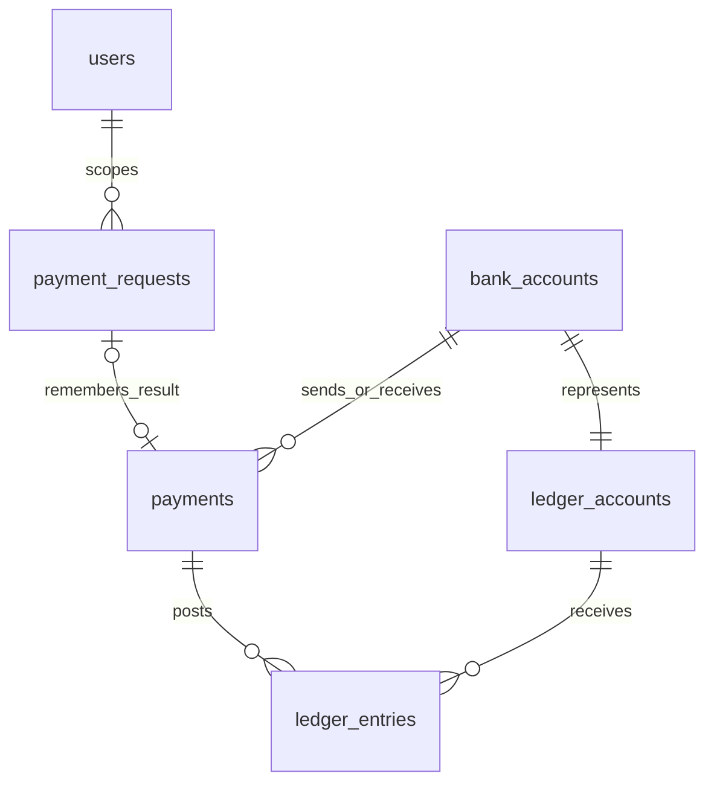

# PayFlow — Phase 7 contacts and request money

PayFlow is a local UPI payment **simulation** for learning. Phase 2 provides
registration → login → JWT access token → protected profile → client-side logout.
Phase 3 adds one fictional bank account and an automatically generated @payflow
identity per authenticated user, starting at **₹0.00 simulated funds**.
Phase 4 adds controlled demo funding, confirmed simulated transfers, a balanced
ledger, idempotent retries, receipts, and history. Phase 5 adds public PayFlow QR
codes, camera/image scanning, and verified recipient selection through the same
explicitly confirmed payment flow. There are no real bank connections, actual
UPI networks, NPCI requests, or real money. Phase 6 refines the frontend with a
blue design system, responsive navigation, and focused screens using these same APIs.
Phase 7 adds personal saved contacts, favorites, derived recent contacts, and
explicitly confirmed money requests using the existing atomic payment engine.

## Run locally (PowerShell)

Backend, in one terminal:

```powershell
cd D:\PayFLow\backend
docker start payflow-postgres-5436
.\.venv\Scripts\python.exe -m pip install -r requirements-dev.txt
.\.venv\Scripts\python.exe -m alembic upgrade head
.\.venv\Scripts\python.exe -m uvicorn main:app --reload --port 8001
```

Keep your existing `backend/.env` database connection. Local JWT settings were
added without replacing that connection or an existing signing key. The signing
key is random and is never printed by application code.

For a fresh checkout, use `backend/.env.example` as a template and supply your
own database credentials. Generate a key directly into the local `.env` without
printing it (run this **only when configuring a new signing key**):

```powershell
.\.venv\Scripts\python.exe -c "from pathlib import Path; import secrets; p=Path('.env'); f=p.open('a', encoding='utf-8'); f.write('\nJWT_SECRET_KEY='+secrets.token_urlsafe(48)+'\nACCESS_TOKEN_EXPIRE_MINUTES=15\n'); f.close()"
```

Never commit `.env`. Changing a signing key invalidates tokens signed with the
previous key. `ACCESS_TOKEN_EXPIRE_MINUTES` accepts integers from 1 to 60 and
defaults to 15. A missing/short signing key prevents startup instead of silently
using a public default. No table creation, schema changes, data deletion, or
database resets happen at application startup. This project expects the existing
`users`, `bank_accounts`, and migrated payment/ledger tables.

Frontend, in another terminal:

```powershell
cd D:\PayFLow\frontend
npm install
npm run dev -- --port 5173 --strictPort
```

Open http://localhost:5173. The default API address is http://localhost:8001.
To change it, copy `frontend/.env.example` to `frontend/.env.local`, edit
`VITE_API_BASE_URL`, then restart Vite. `VITE_` settings are public browser
configuration: never put a signing key or database credentials there.

Use Ctrl+C in each terminal to stop its server. If an older server is already
running, stop that server and restart it to load the new dependencies/settings.

## Phase 7 — Contacts, recent people and request money

Three concepts stay separate:

- A **saved contact** is an entry in your personal address book. It does not mean
  the other person accepted a friendship and does not disclose your address book.
- A **money request** asks a specific PayFlow user for fictional INR. Creating,
  declining, cancelling or expiring it moves no money.
- A **completed payment** is an immutable successful transfer with a balanced
  debit/credit ledger posting. Only this can settle a money request.

### Database and migration

The additive revision is **`0004_contacts_money_requests`**, following
`0003_payment_engine`. The existing `payment_requests` table already stores the
Phase 4 idempotency reservations. It is preserved unchanged. User-facing collect
requests therefore use **`money_requests`**, not a replacement table.

| Table | Purpose and constraints |
| --- | --- |
| `contacts` | UUID contact ID, owner/contact user foreign keys, favorite flag, timestamps. Unique owner/contact pair; CHECK prevents self-contact; owner index. |
| `money_requests` | UUID request ID, requester/payer foreign keys, NUMERIC(18,2) amount, immutable note and terms, state, unique nullable successful payment link, expiry and timestamps, creation key/fingerprint. No self-request; amount >0 and ≤₹100,000; status/link/expiry checks; incoming/outgoing indexes. |
| `request_creation_limits` | Per-user hourly request-creation counter, enforced in PostgreSQL across workers. |

Database triggers prevent changing request participants, amount, note, creation
identity or expiry, prevent deleting request history, and make terminal requests
immutable. A deferred trigger requires a PAID request to reference its exact
successful INR transfer: correct payer, requester, amount, note, and timing.
The payment must have been created during that request's lifetime. Existing
payment immutability, double-entry and balance-reconciliation triggers still run.

Migration verification was performed against fresh isolated schemas first, then
applied to the local database. Hash comparisons of every pre-existing user,
account, payment, ledger, idempotency and lookup record confirmed them unchanged.
The new development tables started empty; no persistent test payments were added.

```powershell
cd D:\PayFLow\backend
.\.venv\Scripts\python.exe -m alembic current
.\.venv\Scripts\python.exe -m alembic upgrade head
.\.venv\Scripts\python.exe -m alembic check
.\.venv\Scripts\python.exe -B reconcile.py
```

The migration contains only new tables, indexes, functions and triggers. Its
downgrade refuses destructive removal. Normal application startup never migrates
or creates tables.

### Protected APIs

Every endpoint below requires the existing `Authorization: Bearer <token>`.
Exact UPI lookup reuses `POST /payments/resolve`; there is no public user listing.

| Method / path | Behavior |
| --- | --- |
| `POST /contacts` | Add by verified `upi_id`; 201 new, 200 existing duplicate. |
| `GET /contacts` | Own address book, favorites first, up to the 200-contact cap. |
| `DELETE /contacts/{id}` | Remove only the authenticated owner's contact; 204. Accounts and history are untouched. |
| `PATCH /contacts/{id}/favorite` | Strict boolean `is_favorite`, owner-scoped. |
| `GET /contacts/recent?limit=10` | Up to 20 deduplicated counterparties from own successful incoming/outgoing transfers, newest interaction first. |
| `POST /payment-requests` | Create using `upi_id`, exact decimal-string `amount`, optional `note`; requires UUID `Idempotency-Key`. 201 new, 200 replay of the existing request's current state. |
| `GET /payment-requests/incoming` | Payer's requests, exact pending count and keyset pagination. |
| `GET /payment-requests/outgoing` | Requester's requests, exact pending count and keyset pagination. |
| `GET /payment-requests/{id}` | Participant-only detail; unrelated users get 404. |
| `POST /payment-requests/{id}/decline` | `{}`; only designated payer, pending requests only. |
| `POST /payment-requests/{id}/cancel` | `{}`; only requester, pending requests only. |
| `POST /payment-requests/{id}/pay` | `{}` and UUID `Idempotency-Key`; only designated payer. Existing safe payment receipt returned. No client amount, sender, owner or balance accepted. |

Lists accept `limit` 1–50 (default 20) and `before=<request UUID>`. Ordering is
stable descending `(created_at,id)`. Responses use only public display name/UPI
for counterparties, plus the contact/request identifiers necessary for actions;
no other user's email, account number, balance or private user ID is exposed.
The existing receipt API remains participant-scoped.

Example bodies in FastAPI `/docs` (use a new UUID key for each intended action):

```json
{ "upi_id": "another-learner@payflow" }
```

```json
{ "is_favorite": true }
```

```json
{ "upi_id": "another-learner@payflow", "amount": "500.00", "note": "Shared fictional lunch" }
```

The last body creates a request; it is **not** a transfer. Response shape:

```json
{
  "id": "<request UUID>",
  "requester": { "display_name": "Asha", "upi_id": "asha@payflow" },
  "payer": { "display_name": "Ravi", "upi_id": "ravi@payflow" },
  "amount": "500.00",
  "note": "Shared fictional lunch",
  "status": "PENDING",
  "payment_id": null,
  "created_at": "<UTC timestamp>",
  "updated_at": "<UTC timestamp>",
  "expires_at": "<UTC timestamp, seven days later>"
}
```

### Lifecycle, privacy and abuse limits

Requests expire after seven days. `PENDING` can become `PAID`, `DECLINED`,
`CANCELLED` or `EXPIRED`; terminal states never reopen. Reads derive EXPIRED
using the database clock even if the stored row still says PENDING. A subsequent
action persists expiry while holding the row lock. There is no scheduler or
background deletion. The frontend also checks expiry periodically; the server
remains authoritative. Successful payment is the only path to PAID.

Lookup allows ten attempts per user per minute, including misses and self-lookups,
using the existing shared PostgreSQL limiter. Saving/creating revalidates the UPI
ID through that same protection. Creation allows ten requests per hour, at most
20 active outgoing requests per requester and 50 active incoming requests per
payer. Sorted transaction-scoped advisory locks serialize the cap checks; no
existing user record is modified. Contacts have a 200-entry personal cap.

All amount rules reuse the transfer schema: decimal strings, positive amounts,
at most two decimal places, maximum ₹100,000, note length ≤140. Extra owner,
amount override or reassignment fields are rejected. CORS now permits the required
PATCH/DELETE methods only for the same configured local frontend origins. Social
and request responses also use `Cache-Control: no-store`.

### Atomic request payment and retry policy

There is one payment engine. `execute_payment` now accepts an optional internal
money-request identifier; normal transfers, QR transfers and funding retain their
existing behavior. Request payment derives immutable terms from PostgreSQL and
uses this transaction order:

1. Reserve/lock the existing user-scoped payment idempotency key. The fingerprint
   includes the collect-request ID as well as the normalized transfer terms.
2. Lock that money-request row with `SELECT FOR UPDATE`; check designated payer,
   state and database-clock expiry. Cancel/decline take only this request lock.
3. Lock sender/recipient accounts in ascending account-ID order, shared with all
   other payments. Recheck expiry after waiting, and check funds under the locks.
4. Use the original transfer code to update cached balances, insert one payment
   and the matching debit/credit ledger entries. Set PAID and its payment link in
   that same transaction, only when the payment succeeds.
5. Check deferred ledger/cache/request invariants and commit everything together.
   No committed transfer is followed by an unrelated status update.

Concurrent same-key retries wait on the database uniqueness reservation. Different
keys for the same already-paid request return its original successful receipt;
the request row lock prevents a second posting. Same key/different request or a
normal-transfer key reused for a collect payment returns 409. Cancel/pay and
decline/pay races serialize on the request row: one valid state transition wins.
Expiry is checked again after account-lock waits, with a DB trigger as a final
guard. Normal transfers and collect payments share the same overspending locks.

Insufficient funds records the existing engine's FAILED payment result and leaves
the collect request pending. Retrying that *same* key returns the same final
failure; after adding fictional funds, explicitly review and confirm a new attempt
with a new key. Unexpected exceptions, deadlocks or uncertain outcomes return a
safe 503 and roll back uncommitted work: keep the original key and retry.

The frontend saves request-payment intent in the existing account-scoped session
metadata before sending, including the request ID. Refresh/relogin in the same
tab can restore that exact intent; no JWT is stored. Creating a collect request
has its own saved creation key and database uniqueness/fingerprint constraint,
so a lost creation response cannot silently duplicate requests. User data in
browser storage is never trusted as authorization or as financial terms.

### Frontend integration and activity

Home includes recent contact avatars, Request Money and Contacts quick actions,
and the pending incoming count. Desktop navigation adds Contacts, Request Money
and Requests. Mobile keeps its five compact bottom actions: new features are
reachable from Home or Profile → Saved Contacts / Money Requests / Request Money.

Contacts has exact lookup, verified public identity, favorites, contact detail,
send/request actions and a removal confirmation. Sending to a contact reuses the
existing verified transfer flow. Requests has incoming/outgoing tabs, dates,
expiry, status, pagination, decline/cancel dialogs and linked receipts. Pay fetches
current request details and opens a keyboard-contained native confirmation with
verified requester, exact amount/note and masked sender account. Only the explicit
confirmation calls the request-pay API. Balance/history/request data refresh after
success. A failed pay leaves the request available; unknown outcomes keep the
original retry key and block another payment. Existing red warnings are preserved.

The lightweight **Request activity** disclosure derives events from loaded own
request states. It requires no notification table, push, email, SMS or WebSockets.
Requests refresh on navigation, own actions, normal payments, or the explicit
Refresh contacts & requests button. Another user's actions are visible after
refresh; there is no live notification service.

### Phase 7 file map

| File | Added/changed responsibility |
| --- | --- |
| `backend/social_models.py` | Contacts, MoneyRequest and creation-limiter SQLAlchemy metadata. |
| `backend/social_schemas.py` | Strict inputs and minimal public responses with exact decimal strings. |
| `backend/social.py` | Authorized contacts, grouped recents, request creation/lists/detail/actions. Never writes balances. |
| `backend/migrations/versions/0004_contacts_money_requests.py` | Three additive tables, constraints/indexes, immutable terms and exact successful payment-link checks. |
| `backend/payments.py` | Existing engine accepts internal collect context; request lock/lifecycle, contextual key fingerprint and atomic PAID link. Original posting code remains shared. |
| `backend/main.py` | Includes router, required CORS methods and no-store paths. |
| `backend/migrations/env.py` | Registers new metadata for Alembic consistency checks. |
| `backend/tests/test_social.py` | 24 isolated PostgreSQL tests for privacy, lifecycle, limits, immutable terms, ledger, rollback, idempotency and races. |
| `backend/tests/test_migrations.py` | New head and table assertions; keeps baseline/legacy data-preservation checks. |
| `frontend/src/socialApi.ts` | Typed contact and collect-request API helpers. |
| `frontend/src/SocialPanel.tsx` | Contacts, recents, request composition/inbox/activity, scoped creation retries and confirmations. |
| `frontend/src/ConfirmDialog.tsx` | Native modal with focus restoration, Escape and explicit keyboard containment. |
| `frontend/src/moneyInput.ts` | Existing exact input validation extracted for reuse by transfer and collect forms. |
| `frontend/src/PaymentPanel.tsx` | Existing posting/retry path handles request payments, restores request intents and refreshes social data. |
| `frontend/src/api.ts` | Correctly handles the contact API's successful 204 empty response. |
| `frontend/src/navigation.ts`, `frontend/src/DashboardShell.tsx`, `frontend/src/App.css` | New destinations, compact mobile access, social cards/dialog styling. |
| `frontend/src/SocialPanel.test.tsx` | Contact/requests UI, confirmation/focus, empty/errors, create/pay recovery, insufficient funds and refresh tests. |
| `frontend/src/App.test.tsx`, `frontend/src/Experience.test.tsx` | Existing focused fixtures supply empty social API responses; auth and navigation assertions preserved. |
| `frontend/qa/phase7-browser.mjs` | Two-user Chromium contacts/request lifecycle and committed-response-loss test. |
| `frontend/qa/phase6-browser.mjs`, `frontend/qa/isolated_backend.py` | Existing QR/direct browser checks extended safety guard and development social-table hash checks. |
| `README.md` | Lifecycle, concurrency, schema, endpoints and test instructions. |

### Phase 7 verification and exact commands

Executed: **82 PostgreSQL backend tests passed** (58 regression +24 new),
**127 React tests passed** (112 previous +15 social tests), TypeScript/production
build and ESLint passed. Alembic check reports no pending schema differences.
Before/after backend test hashes and migration hashes confirmed existing records
unchanged. Development reconciliation reports balanced, no account mismatches and
no invalid postings.

Real Chromium checks used fresh `payflow_phase4_tests` schemas: two users registered,
created accounts, saved/favorited/viewed/removed a contact, created a ₹500 request
without moving funds, and explicitly paid it after funding the payer ₹1,000. A
lost response after commit was recovered using the same key: exactly one transfer,
request PAID, requester ₹500, payer ₹500, matching receipt accessible to both.
Decline, cancel, recent contacts, pending count, keyboard modal containment,
logout, and layouts at 320/390/768/1024/1440px passed. The previous direct/real-PNG
QR transfer browser harness also passed. No development test payments were made.

Normal local run, separate terminals:

```powershell
cd D:\PayFLow\backend
docker start payflow-postgres-5436
.\.venv\Scripts\python.exe -m alembic upgrade head
.\.venv\Scripts\python.exe -m uvicorn main:app --reload --port 8001
```

```powershell
cd D:\PayFLow\frontend
npm install
npm run dev -- --port 5173 --strictPort
```

Tests:

```powershell
cd D:\PayFLow\backend
$env:REGISTER_TEST_POSTGRES = '1'
.\.venv\Scripts\python.exe -B -m unittest discover -s tests -v
Remove-Item Env:REGISTER_TEST_POSTGRES
.\.venv\Scripts\python.exe -m alembic check
.\.venv\Scripts\python.exe -B reconcile.py
```

```powershell
cd D:\PayFLow\frontend
npm test
npm run build
npm run lint
```

For safe manual/browser testing, use the **isolated QA server and Vite commands in
the Phase 6 section below**. They run the latest migration in a fresh test schema.
With those servers running and `PLAYWRIGHT_MODULE` pointing to installed test
tooling, run:

```powershell
cd D:\PayFLow\frontend
node qa/phase7-browser.mjs
node qa/phase6-browser.mjs
```

Manual two-user check on those isolated servers:

1. Create A and B in separate browser profiles and create their demo accounts.
2. B adds ₹1,000 demo funds. A uses Contacts to verify B's exact UPI ID, saves B,
   favorites B and opens B's contact profile.
3. A chooses Request Money, enters `500.00` and a note, reviews and sends. Verify
   A still has ₹0 and B still has ₹1,000; the request is PENDING.
4. B refreshes contacts/requests on Home, opens the pending incoming request,
   chooses Pay, checks A's UPI ID and amount and explicitly confirms.
5. Verify B has ₹500, A has ₹500 after account refresh, request is PAID, and both
   participants can open its same transaction receipt. Reconciliation passes.
6. Create another request and decline it as B; create another and cancel it as A.
   Neither action changes balances. Remove A's contact entry: accounts, requests
   and payment history remain intact.

Stop the QA backend with Ctrl+C for its final ledger/hash checks, then stop test
Vite. Test schemas are retained; no DROP/TRUNCATE cleanup is performed. Close the
test Vite terminal or clear `VITE_API_BASE_URL` before using the normal API again.

Known limitations: request activity is derived from loaded pages and is refreshed,
not pushed live. Expiration is lazy and server-authoritative, without a scheduler.
Saved contacts are not mutual friends. Abuse limits are deliberately small demo
controls; a production service would need broader abuse monitoring and operational
controls. Physical camera and screen-reader hardware were not tested in this
phase; existing camera tests, synthetic-media checks and real image decoding
regressions remain covered. No Phase 8 features or real payment integration exist.

## Phase 6 — Frontend experience and UI/UX (previous phase)

This phase changes the React experience only. Authentication, API contracts,
PostgreSQL models, migrations, financial transactions, ledger constraints, and
QR payload validation remain unchanged. No runtime dependency was added for Phase 6.

### Screens and component structure

`App` keeps the existing in-memory authentication hook. Once signed in,
`DashboardShell` provides the sidebar, page title, quick actions, and navigation.
`AccountPanel` remains mounted for that session and owns the current account.
Its `PaymentPanel` also stays mounted when moving between screens. HTML `hidden`
removes inactive content from keyboard navigation and the accessibility tree
without destroying a reviewed payment, draft amount, or uncertain retry key.
Logout unmounts the entire authenticated tree and releases the QR scanner.

| Screen | Behavior |
| --- | --- |
| Home | Personalized welcome, simulated balance, bank summary, copy UPI ID, four quick actions, fixed demo funding, three recent transactions. |
| Send Money | Verify recipient through the backend, enter amount/note, review sender and recipient, explicitly confirm, view receipt. |
| Scan QR | Existing native modal with explicit camera start, permission feedback, upload fallback, and cleanup. Scanning selects a verified recipient; it never sends money. |
| My QR | QR automatically displayed on this screen, readable public UPI ID, copy and PNG download. |
| Transactions | Full loaded history, incoming/outgoing/funding filter, pagination, receipt access, loading and empty states. |
| Bank Account | Masked demo account details, exact balance, UPI ID, refresh and fixed fictional funding. |
| Profile | Existing name, email, member details, profile refresh, session explanation and linked account. Logout stays available in the shell. |

Desktop uses all seven destinations in a sidebar. Mobile uses five bottom actions:
Home, Send Money, Scan QR, Transactions, Profile. **My QR** is available from the
Home quick actions; **Manage account** on Home or Profile opens Bank Account.
The avatar opens Profile. Active navigation uses `aria-current="page"`.
Navigation is local React state, so refreshing still signs out intentionally;
it does not create public routes or persist JWTs.

History filtering is client-side and clearly applies only to loaded pages.
Load older payments to include earlier records. The backend pagination is unchanged.

### Design system and accessibility

`index.css` defines semantic CSS variables for blue accents, white surfaces,
neutral backgrounds, text, borders, success and danger colors, spacing, radii,
and shadows. `App.css` applies the shared controls/cards and responsive layouts.
Breakpoints are 720px (bottom navigation), 1000px (compact workspace), and 1200px
(two-column quick actions). Mobile inputs use readable text and controls of at
least 44px. Currency grouping uses `BigInt` and Indian grouping rather than
binary floating-point conversion: `1250.50` is displayed as **₹1,250.50** while
the exact decimal API payload stays unchanged.

Warnings and errors use red text with pale red backgrounds; successful actions
use green. Text labels and live regions communicate status as well as color.
Forms retain semantic labels, password fields have explicit Show/Hide actions,
focus outlines are visible, the workspace has a skip link, and navigation focuses
the page heading. Recipient verification focuses the amount field. Native QR
dialogs retain Escape, focus containment/restoration, and camera cleanup. Reduced
motion disables animations and transitions. No unsupported settings were added.

Insufficient balances are blocked before review, with a second check before a new
send. PostgreSQL remains the authority under locks. An uncertain request keeps its
original idempotency key and can be retried even if its first attempt reduced the
balance. Switching screens cannot generate a replacement key or start a new scan
while that payment is unresolved.

### Phase 6 files

| File | Purpose |
| --- | --- |
| `frontend/src/navigation.ts` | Typed destinations and screen descriptions. |
| `frontend/src/Icon.tsx` | Small shared SVG icon set; decorative icons are hidden from screen readers. |
| `frontend/src/DashboardShell.tsx` | Desktop/mobile navigation, welcome header, quick actions, focus management and logout. |
| `frontend/src/PasswordField.tsx` | Accessible visibility toggle without storing passwords. |
| `frontend/src/CopyUpi.tsx` | Reusable clipboard action with success and failure feedback. |
| `frontend/src/formatMoney.ts` | Exact Indian currency display with BigInt. |
| `frontend/src/PaymentHistory.tsx` | Recent activity/full list, direction/status styling, loaded-page filter and receipt actions. |
| `frontend/src/App.tsx` | Uses the new shell after login and reusable password fields; preserves registration/login/profile logic. |
| `frontend/src/AccountPanel.tsx` | Current account shared across screens, copy/manage actions and precise balance formatting. |
| `frontend/src/PaymentPanel.tsx` | View visibility, direct recipient-first entry, step indicators and shared history; existing posting/retry engine preserved. |
| `frontend/src/MyQrCode.tsx` | Supports opening its QR immediately on the dedicated My QR screen. |
| `frontend/src/index.css`, `frontend/src/App.css` | Tokens, blue visual design, responsive shell, focus, contrast, controls and reduced motion. |
| `frontend/src/Experience.test.tsx` | Navigation, verified recipient steps, confirmation, navigation-safe uncertain retry, filtering, copy, exact currency and keyboard focus tests. |
| `frontend/src/App.test.tsx`, `frontend/src/AccountPanel.test.tsx`, `frontend/src/PaymentPanel.test.tsx` | Existing regressions updated for intentional navigation and grouped currency display. |
| `frontend/qa/isolated_backend.py` | Optional browser-test server using existing test fixtures in a fresh dedicated test schema. Hash-compares development records and reconciles the ledger on graceful exit; never deletes schemas. |
| `frontend/qa/phase6-browser.mjs` | Reproducible Chromium two-user checks and screenshots, with a guard blocking writes to any API except isolated port 18016. |
| `README.md` | Phase 6 design, file map, navigation, commands, verification and limitations. |

### Run and test Phase 6

Use the normal local commands above. No Phase 6 migration is needed. From
`D:\PayFLow\frontend` run:

```powershell
npm test
npm run build    # includes TypeScript checking
npm run lint
```

Backend regressions use the isolated/rollback-safe fixtures described below:

```powershell
cd D:\PayFLow\backend
$env:REGISTER_TEST_POSTGRES = '1'
.\.venv\Scripts\python.exe -B -m unittest discover -s tests -v
Remove-Item Env:REGISTER_TEST_POSTGRES
```

Phase 6 verification: **112 React tests passed**, **58 PostgreSQL backend tests
passed**, TypeScript/production build and ESLint passed. Alembic consistency was
included in the backend regression suite. A full-row hash comparison before and
after the backend suite confirmed development records unchanged, without printing
credentials or private data.

Real Chromium checks used a fresh schema in `payflow_phase4_tests`, not the
development database. Two users registered/logged in, created accounts, funded
₹1,000, transferred ₹12.30 directly, then transferred ₹125.50 using a real downloaded
PNG and local ZXing decoding. The second transfer's committed response was
deliberately lost: retrying used the same key, produced one posting, and left
the sender at **₹862.20** and recipient at **₹137.80**. Both histories and receipts,
copy/download, red insufficient-funds feedback, keyboard modal containment,
synthetic camera cleanup, permission denial, reduced motion, logout, and widths
320/390/768/1024/1440px were checked. No browser JavaScript errors were observed.

Optional reproducible browser QA uses Playwright as a separate test tool, not an
application dependency. Install Playwright/Chromium into a temporary tooling
directory, or use your existing installation. Stop the normal frontend first so
the test frontend can occupy port 5173. In separate terminals:

```powershell
# Terminal 1, repository root. Uses existing backend venv and dedicated test DB.
cd D:\PayFLow
.\backend\.venv\Scripts\python.exe -B frontend/qa/isolated_backend.py

# Terminal 2. This environment setting applies only to this shell.
cd D:\PayFLow\frontend
$env:VITE_API_BASE_URL = 'http://127.0.0.1:18016'
npm run dev -- --host 127.0.0.1 --port 5173 --strictPort

# Terminal 3: point to the absolute directory containing the Playwright package.
cd D:\PayFLow\frontend
$env:PLAYWRIGHT_MODULE = 'C:\path\to\tooling\node_modules\playwright'
$env:PAYFLOW_SCREENSHOTS = "$env:TEMP\payflow-phase6-screenshots"
node qa/phase6-browser.mjs
```

Ctrl+C the QA backend for its final ledger/data checks, then stop the test Vite
server. Close terminal 2 or remove its `VITE_API_BASE_URL` before starting the
normal frontend again. Test schemas are deliberately retained to avoid destructive
cleanup. Do not point this browser harness at the development API.

For manual checks without changing development balances, use those QA servers
with two browser profiles. Visit Home → My QR for user A; download the QR. User B
adds demo funds, chooses Send Money to test direct verification, then Scan QR →
upload A's PNG → enter amount → Review → Confirm. Check Transactions, open a
receipt, and refresh A's account/history. Review the sender account before every
confirmation. Use the normal development server only when you intend to create
persistent fictional payments.

Known limitations: physical webcam/phone optical scanning and screen-reader
hardware were not tested; camera permissions/cleanup were exercised with browser
synthetic media and automated tests. This is not a formal accessibility audit.
Navigation deliberately does not survive a page refresh, and client-side history
filters cover loaded pages. All existing session and sandbox security limitations
continue to apply. Phase 7 now extends this shell with contacts and requests as described above.

## Phase 5 — QR payments (previous phase)

**Show QR → scan/upload → validate → resolve recipient → enter amount → review
sender/recipient → explicitly confirm → existing transfer → receipt.**

No backend endpoint, database model, or migration was needed for Phase 5. At that handoff Alembic was at
`0003_payment_engine`. QR content is a public address, never payment authority.

### Canonical versioned payload

```text
payflow://pay?v=1&upi=recipient-123abc%40payflow
```

Only this exact grammar is accepted:

- Literal lowercase `payflow://pay`, no path, port, authority credentials, or fragment.
- Exactly `v=1` followed by `upi`, with no extra or duplicate parameters.
- UPI local part: 1–40 lowercase ASCII letters/digits/hyphens, starting with a
  letter/digit. The domain suffix is exactly `%40payflow` (`@` encoded as `%40`).
- Raw contents are capped at 160 characters before parsing. Whitespace, reordered
  keys, alternate escaping, double encoding, and unsupported versions are rejected.

The code contains **only version and public UPI ID**. It contains no JWT,
password, name, amount, note, account number, balance, or private profile field.
It is not `upi://pay` and is not an official bank/NPCI payment request. Standard
QR readers can decode its text; PayFlow's in-app scanner handles this sandbox flow.

The parser never navigates, fetches an embedded URL, executes content, or inserts
QR text as HTML. Self-payments are rejected locally and by the backend. Display
names/banks come only from authenticated `POST /payments/resolve`, never from the
QR. "Verified" means resolved in PayFlow's local database, not real bank/KYC
verification or a signed QR. A printed code can be replaced: always check the
recipient before confirming.

### Generation, scanning, and resource cleanup

**My QR Code** uses `qrcode` to generate a standard PNG locally when **Show my QR**
is opened. Dark modules on white, medium error correction, and a four-module quiet
zone keep it readable; no logo obscures it. The public ID, Copy action, and PNG
download accompany it. Clipboard failure leaves readable/selectable text.

**Scan QR** and **Upload QR Image** open an accessible native dialog. Camera
access starts only after **Start camera**, preferring the rear lens without
requesting a microphone. Opening the dashboard/dialog or choosing upload never
requests camera access. ZXing is loaded lazily when decoding is actually needed.

Owned tracks and decoding controls stop on recognition (including invalid codes),
Stop, Close, Escape, unmount, and logout/auth expiry. A late permission grant is
immediately released after cancellation. Preview initialization is bounded to
10 seconds after stream acquisition; a stalled preview stops and offers upload.
The permission prompt itself can wait for a user decision, with Close available.
Late lookup results cannot populate a recipient after closing the scanner.

Uploads accept PNG/JPEG/WebP up to 5 MB and 4096 × 4096 decoded pixels. Other
declared formats, including SVG, are rejected. Images are decoded locally through
temporary blob URLs, revoked on success/error/cancellation. **Image bytes never
go to FastAPI.** Use one clear QR per image, including its white border.

Camera and clipboard normally require HTTPS or localhost plus browser permission.
Plain HTTP at a phone's LAN address may not expose the camera; use upload or
proper HTTPS hosting. Existing backend CORS restrictions were not widened: mobile
hosting also needs explicitly allowed origins. Modern native-dialog/canvas/media
browsers are the target. Keyboard focus stays in the modal, Escape closes it,
and focus returns to the trigger. There is no permission bypass or real UPI-app launch.

### Existing payment integration

`AccountPanel` passes its authenticated account's public display fields to the
existing `PaymentPanel`. The QR scanner validates an ID and calls recipient
lookup only. It has no transfer API. After lookup, the form shows the backend's
name/bank, a read-only UPI ID, and an **empty amount**. The user may choose another
recipient explicitly.

**Review payment** reuses the existing exact amount rules and resolves identity
again. Confirmation shows recipient, amount, optional note, and masked sender
account. Only **Confirm and send** invokes the existing `POST /payments/transfer`.
The existing UUID key, session-storage recovery, atomic locks, ledger, receipt,
balance refresh, and history are reused. Unknown outcomes retain the same key and
payload; scanning/new money actions stay disabled until that intent is resolved.

### Phase 5 files added or changed

| File | Purpose |
| --- | --- |
| `frontend/src/qrPayload.ts` | Versioned public payload generation; strict bounds/grammar; self rejection. |
| `frontend/src/qrMedia.ts` | Lazy PNG generation/ZXing decoding, owned camera sessions, startup timeout, friendly errors, local file limits, cancellation, and blob cleanup. |
| `frontend/src/MyQrCode.tsx` | Show/hide, readable ID, copy feedback, PNG download, and generation errors. Accepts only an ID, never a token. |
| `frontend/src/QrScanner.tsx` | Camera/upload dialog, explicit start/stop, keyboard focus, Escape, loading/errors, validation, and cancellation of late results. |
| `frontend/src/PaymentPanel.tsx` | QR actions, backend-verified selection, amount/review integration, and masked sender details; existing transfer/receipt/retry code remains. |
| `frontend/src/AccountPanel.tsx` | Supplies the authenticated account's public fields to the payment panel. |
| `frontend/src/App.css` | Responsive QR card/dialog, white QR presentation, verified recipient, upload styling, and 44px action targets. |
| `frontend/package.json`, `package-lock.json` | Add `qrcode`, ZXing browser/core, and development-only `@types/qrcode`. Compatible ZXing browser 0.1.5/core 0.21.3 preserve Node 22; the newer line requires Node 24. |
| `frontend/src/qrPayload.test.ts` | Canonical, malformed, external, version, size, self cases, and a real encoder/decoder QR-matrix round-trip. |
| `frontend/src/qrMedia.test.ts` | PNG options, permissions/unavailable cameras, track lifecycle, late grants, timeout/late controls, image limits/errors, and cancellation cleanup. |
| `frontend/src/QrScanner.test.tsx` | Dialog keyboard behavior, explicit camera start/cleanup, upload validation, unknown recipients, copy/download, and generation errors. |
| `frontend/src/QrPaymentFlow.test.tsx` | QR through existing confirmation/transfer/receipt, insufficient funds, duplicate submits, same-key retries, lookup/auth failures, closed dialogs, and logout. |
| `frontend/src/test-setup.ts` | Native-dialog shims only for jsdom; real-browser tests use actual browser modal behavior. |
| `README.md` | Format, architecture, security, camera requirements, runbook, and results. |

Backend files, credentials, secrets, models, migrations, ledger, and API helpers
were reused without changes. Decoder code is a lazy chunk, not part of the initial
dashboard download. Phase 6 now organizes these controls into dedicated screens.

### Run and manually verify with two users

Use the backend/frontend commands above. For an existing checkout the only new
installation is `npm install` in `D:\PayFLow\frontend`. No new migration is required;
`alembic upgrade head` is still safe and does nothing when already current.

1. User A signs in and creates a demo account if needed. Open **Show my QR** and
   **Download QR as PNG**. The readable ID and optional Copy action are beneath it.
2. User B signs in in a second tab/profile, creates an account, and adds a ₹1,000
   demo funding action if starting from zero.
3. B chooses **Scan QR → Start camera**, grants permission, and points at A's code.
   Alternatively choose **Upload QR Image**, then select A's PNG in the dialog.
4. Verify the resolved name, bank, and UPI ID. No funds have moved. Enter `125.50`
   and an optional note; choose **Review payment**.
5. Check recipient, masked sender account, and amount; explicitly choose
   **Confirm and send ₹125.50**. From fresh balances, B becomes ₹874.50 and A ₹125.50.
6. A clicks **Refresh accounts** and **Refresh history**. Both users can open their
   incoming/outgoing entry and see the same transaction ID in the receipt.
7. Try your own QR, a website/official UPI QR, and a corrupt image: each must fail
   without navigation/payment. Deny camera permission to see upload guidance.
   Close/Escape or log out and verify the browser's camera indicator turns off.
8. For uncertain payment outcomes use **Retry same request**, never another key.
   The existing account-scoped recovery survives refresh/re-authentication in the
   tab. QR actions are disabled while the earlier payment remains unresolved.

Manual payments save fictional records intentionally. Automated browser payments
used a fresh schema in the separate `payflow_phase4_tests` database, never the
development database. Test schemas were retained, with no destructive cleanup.

### Automated commands and actual verification

```powershell
cd D:\PayFLow\frontend
npm install
npm test
npm run build
npm run lint
```

```powershell
cd D:\PayFLow\backend
$env:REGISTER_TEST_POSTGRES = '1'
.\.venv\Scripts\python.exe -B -m unittest discover -s tests -v
Remove-Item Env:REGISTER_TEST_POSTGRES
.\.venv\Scripts\python.exe -m alembic check
.\.venv\Scripts\python.exe -B reconcile.py
```

Executed for Phase 5: **99 frontend tests passed**, including all 35 previous
frontend tests; **58 PostgreSQL tests passed**, including concurrency and all
backend regressions, with no skips in that run. TypeScript, production build,
ESLint, and Alembic consistency passed. Runtime dependency audit reported zero
vulnerabilities; existing development-tool warnings remain. Development rows,
balances, credentials, and ledger data were compared before/after backend tests
and were unchanged.

Chromium verified dashboard PNG generation, clipboard/download, actual local
upload decoding, two-user ₹125.50 transfer only after explicit confirmation,
exact balances, both histories/receipts, actual-image self/external-URL rejection,
mobile width without overflow, native dialog keyboard behavior, synthetic-video
QR recognition, and track cleanup on recognition/close/logout. The isolated QR
browser payments and development ledger both reconciled without mismatches.

**Hardware limit:** physical webcam/phone scanning could not be tested. Permission
and lifecycle cases were tested with mocks and native synthetic video streams;
actual PNG decoding was verified in Chromium. Device lens focus, lighting, mobile
OS permissions, and individual browsers still need manual checks. A non-producing
synthetic device exposed a preview stall; startup is now bounded and releases
tracks before offering upload. QR images are unsigned public addresses, not proof
of ownership or bank verification. All existing local-development security limits
continue to apply.

References: [QR encoder](https://github.com/soldair/node-qrcode),
[ZXing browser decoder](https://github.com/zxing-js/browser), and
[camera security/permissions](https://developer.mozilla.org/en-US/docs/Web/API/MediaDevices/getUserMedia).

## Phase 2 foundation files and important code

| File | Role and changes |
| --- | --- |
| `backend/main.py` | Preserves registration and health checks. Adds JSON `POST /login`, protected `GET /me`, safe database error responses, and `Cache-Control: no-store` on authentication responses. CORS still permits only the two local Vite origins, now including POST and the Authorization header. |
| `backend/schemas.py` | `LoginRequest` shares email normalization with `RegisterRequest`. Registration keeps its 8–128-character password and trimmed 1–100-character name requirements. Login accepts 1–128 characters so wrong passwords can receive generic credential errors. `TokenResponse` describes the login response. `UserResponse` permits only public profile fields. Extra request fields are rejected. |
| `backend/security.py` | Owns Argon2id hashing, a random dummy hash for unknown-email checks, JWT creation, and the `get_current_user` dependency. `HTTPBearer(auto_error=False)` lets the app return a consistent 401 for missing or invalid authorization. |
| `backend/config.py` | Loads `.env` beside the module, validates the signing key and configured expiry, and keeps the existing DATABASE_URL setting. |
| `backend/requirements.txt` | Adds maintained PyJWT 2.x for JWT signing and verification. |
| `backend/.env.example` | Safe configuration template; has placeholders and no signing secret. |
| `backend/.env` (local only) | Adds a generated key and expiry when absent; keeps the existing database configuration. Ignored by Git. |
| `backend/tests/test_register.py` | Keeps registration coverage, shares its isolated database fixture with auth tests, and checks safe 503 responses for other database constraints. |
| `backend/tests/test_auth.py` | Covers login, generic errors, token issuance, claims, expired/tampered/malformed tokens, missing authorization, profile privacy, nonexistent users, CORS, and safe database failures. |
| `frontend/src/api.ts` | One API base URL and fetch helper. Defines response types, sends JSON/Bearer headers, disables caching, times out requests after 10 seconds, and turns network/API failures into readable messages. |
| `frontend/src/useAuth.ts` | Small React hook holding the token, public user, and expiry **in memory**. Loads `/me` after login, clears sessions on expiry/401, and ignores profile responses from a logged-out session. |
| `frontend/src/App.tsx` | Registration/login forms, confirmation checks, required fields, loading/disabled states, feedback, profile refresh, logout, and the existing backend check. Passwords are read from the form rather than stored in persistent browser storage. |
| `frontend/src/App.css`, `src/index.css` | Responsive interface, shared field/button styling, visible keyboard focus, feedback, and mobile layout. |
| `frontend/index.html` | PayFlow page title and description. |
| `frontend/.env.example` | Public API-address template. |
| `frontend/package.json`, `package-lock.json` | Add the test script and development-only Vitest, Testing Library, and jsdom dependencies. No frontend runtime library was added. |
| `frontend/vitest.config.ts`, `src/test-setup.ts` | DOM test environment and cleanup of rendered components, fetch mocks, spies, and timers between tests. |
| `frontend/src/App.test.tsx` | Exercises registration/login/profile/logout, confirmation, duplicate-email and credential errors, network failure, disabled forms, expiry, rejected tokens, late requests, and losing authentication on page remount. |
| `.gitignore` | Keeps local secrets, virtual environments, caches, dependencies, and generated builds out of source control. Allows `.env.example` templates. |
| `README.md` | This runbook, request-flow explanation, manual checks, test instructions, and limitations. |

The Phase 2 authentication dependencies and `database.py` are reused unchanged.
`models.py` now also defines `BankAccount`; apply migrations before starting the API.

## Phase 3 architecture and file changes

This section documents the existing account foundation. Phase 4 extends it with
the protected funding and transfer flows described in the Phase 4 section below.



No account status is stored because Phase 3 has no freeze/close/delete actions.
`user_id` references `users.id` with `ON DELETE RESTRICT`; a unique constraint
enforces one account per user even if two requests arrive together. Account
numbers and UPI IDs each have their own unique constraint. Every column is
required. Check constraints restrict banks, account-number and UPI formats,
and finite nonnegative balances. The UPI ID belongs to the account, which belongs
to exactly one user. It is created when that user creates their account.

| New or changed file | Phase 3 purpose |
| --- | --- |
| `backend/models.py` | Adds the `DemoBank` enum, `BankAccount`, named constraints, Decimal balance, and optional `User.bank_account` relationship. No existing user columns are altered. |
| `backend/account_schemas.py` | Accepts only a valid `bank_name`; rejects owner IDs, numbers, UPI IDs, balances, and all other extra fields. Defines safe output and serializes Decimal to exactly two decimal places as a JSON string. |
| `backend/accounts.py` | Small protected router for bank choices, creation, listing, and owner-only detail. Generates identifiers, masks account numbers, and retries uniqueness collisions within savepoints. |
| `backend/main.py` | Includes the account router and marks account responses `Cache-Control: no-store`. Reuses existing authentication, CORS, validation, and safe 503 database handling. |
| `backend/requirements.txt` | Adds Alembic for versioned migrations. |
| `backend/alembic.ini` | Locates migration scripts; contains no credentials or connection URL. |
| `backend/migrations/env.py` | Loads the existing configured database URL and model metadata. Runs transactional online migrations, with a five-second lock timeout for normal CLI use. Accepts a supplied connection for isolated migration tests. |
| `backend/migrations/script.py.mako` | Template for generating future migration revisions. The default downgrade refuses destructive reversal. |
| `backend/migrations/versions/0001_users_baseline.py` | Checks and adopts the pre-Alembic users table without modifying rows. On a fresh database, explicitly creates its Phase 2 schema. Refuses unexpected existing schemas. |
| `backend/migrations/versions/0002_bank_accounts.py` | Creates only the new account table and its constraints; no user data update, table replacement, or deletion. |
| `backend/tests/test_register.py` | Extends the shared isolated SQLite fixture with the account table and enabled foreign-key enforcement. Existing auth/registration tests remain. |
| `backend/tests/test_accounts.py` | Tests auth, ownership, masks, zero balance, exact serialization, bad/extra input, uniqueness, retries, bounds/formats, FK/CHECK/NOT NULL constraints, and safe errors. |
| `backend/tests/test_migrations.py` | Tests fresh upgrades, repeat upgrades, model/migration agreement, and preservation of existing users in temporary transaction-scoped PostgreSQL schemas. |
| `frontend/src/api.ts` | Adds an account response type with `balance: string` and authenticated account/bank API functions using the existing request helper. |
| `frontend/src/AccountPanel.tsx` | Loads the user's account and bank choices; displays loading, retry/error, empty/create, and account-card states. Handles 401 by calling the existing logout mechanism. Ignores responses after logout/unmount. |
| `frontend/src/App.tsx` | Mounts the account panel only for authenticated sessions; logout unmounts it and removes account details. |
| `frontend/src/App.css` | Extends existing styles with responsive account card, bank picker, and profile/dashboard layout. |
| `frontend/src/AccountPanel.test.tsx` | Tests bank choices, loading, empty/display/create states, string precision, failures/retries, disabled submissions, expired sessions, and late responses. |
| `frontend/src/App.test.tsx` | Preserves Phase 2 scenarios with account-aware mocks; adds a check that logout removes the displayed account and UPI ID. |
| `README.md` | Adds Phase 3 architecture, migrations, API usage, design decisions, and verification instructions. |

Credentials, JWT secrets, password behavior, and the memory-only auth hook are
unchanged. No frontend or API dependency was added apart from backend Alembic.

### Apply migrations safely

From `D:\PayFLow\backend`:

```powershell
.\.venv\Scripts\python.exe -m pip install -r requirements-dev.txt
.\.venv\Scripts\python.exe -m alembic current
.\.venv\Scripts\python.exe -m alembic upgrade head
.\.venv\Scripts\python.exe -m alembic current
.\.venv\Scripts\python.exe -m alembic check
```

Phase 3 introduced `0002_bank_accounts`; the current head is now
`0004_contacts_money_requests`. These migrations are applied to the configured local
database and existing records were preserved. Repeating `upgrade head` is a no-op.

No manual `stamp`, database reset, or `Base.metadata.create_all()` is required.
The baseline inspects an existing users table; online migration is intentional
and offline SQL generation is disabled. Both revisions refuse downgrades rather
than dropping user/account data. Changes should use reviewed forward migrations.
If a table differs unexpectedly or a lock cannot be acquired, migration fails
instead of silently modifying/replacing it. Migration files freeze their original
schema; change banks or constraints later through a new revision.

To create a future revision after deliberately changing models:

```powershell
.\.venv\Scripts\python.exe -m alembic revision --autogenerate -m "describe the change"
```

Review generated SQL/schema changes before applying them, especially any removal.

### Account creation and UPI generation

1. React fetches `GET /accounts` and `GET /accounts/banks` with the existing
   Bearer token. The server is the source of truth for bank choices.
2. The user chooses **Grove Demo Bank**, **Orbit Demo Bank**, or **River Demo Bank**.
   React sends only `{ "bank_name": "Grove Demo Bank" }` to `POST /accounts`.
3. `get_current_user` validates the JWT and loads its user. The backend derives
   ownership from that user; the client cannot nominate another owner.
4. The server creates a number with `SIM` plus 16 cryptographically random digits.
   It builds a safe lowercase ASCII name slug (fallback `learner`) plus a random
   12-hex-character suffix and `@payflow`. For example,
   `harsh-kumar-a1b2c3d4e5f6@payflow`. Users cannot claim an arbitrary address.
5. The server sets `Decimal("0.00")` regardless of client wishes. The database
   also supplies a zero default for inserts that omit the balance.
6. A savepoint encloses each attempted insert. A number/UPI uniqueness collision
   rolls back that attempt and generates fresh identifiers, up to five attempts.
   A duplicate-owner constraint returns 409. Other database errors use the
   existing safe 503 handler. On success the session commits the single account.
7. Only masked account numbers are returned. The UI shows the exact balance,
   bank name, masked number, and sandbox-only UPI ID. Phase 4 adds funds and sends
   only through the controlled payment engine, never through account updates.

`NUMERIC(18,2)` stores up to 16 whole-number digits and two fractional digits.
Python `Decimal` avoids binary floating-point rounding (such as in `0.1 + 0.2`).
The API emits `"0.00"`, not `0.0`. React keeps the balance as a string and never
uses `Number` or `parseFloat` to display it. All balances in this phase use the
single simulated INR denomination; there is no currency-conversion feature.

### Phase 3 API examples and manual checks

Use http://localhost:8001/docs. Register/login as described below, then click
**Authorize** and enter only the JWT value.

| Endpoint | Expected result |
| --- | --- |
| `GET /accounts/banks` | 200; predefined fictional bank names. |
| `GET /accounts` | 200; `[]` before creation, otherwise only the signed-in user's account. |
| `POST /accounts` | 201 with the account; 409 if this user already has one. |
| `GET /accounts/{account_id}` | 200 for the owner; 404 for missing or another user's account. |

Creation request:

```json
{ "bank_name": "Grove Demo Bank" }
```

Illustrative response (IDs/timestamps/identifiers will differ):

```json
{
  "id": 1,
  "bank_name": "Grove Demo Bank",
  "masked_account_number": "SIM •••• •••• •••• 1234",
  "upi_id": "harsh-kumar-a1b2c3d4e5f6@payflow",
  "balance": "0.00",
  "created_at": "2026-11-03T12:00:00Z"
}
```

Check these behaviors:

1. With no authorization, account endpoints return 401.
2. An unused user sees an empty account list. Create one account and verify the
   balance is the JSON **string** `"0.00"`; the full account number is absent.
3. Repeat creation: expect 409 and still exactly one account.
4. Choose an unlisted bank or include `balance`, `user_id`, `account_number`, or
   `upi_id` in the request: expect 422, without creating anything.
5. Sign in as a different test user and request the first account's ID: expect
   404. Its list remains empty until it creates its own account.
6. In React, sign in and choose a demo bank. Submit once, inspect the card, refresh
   accounts, then log out: account details disappear. Sign in again to retrieve
   the same persisted account. Browser refresh still signs out as in Phase 2.
7. Test phone width, account-loading failures, and retry using Refresh accounts.
   A timed-out creation may still have committed on the server; refresh before
   retrying. The database unique constraint prevents a second account.

Manual creation saves fictional records in the development database. Do not
delete those records or reset volumes as part of these checks.

### Next phase

Phase 4 now implements simulated transfers with atomic debits/credits,
concurrency control, and idempotency. Account APIs still cannot accept balances;
only the new controlled demo-funding endpoint adds fictional funds. Real UPI
networks and real banking remain outside this learning project.

## Phase 4 — simulated payment engine

Current flow: **demo funds → exact recipient lookup → explicit confirmation →
atomic transfer → immutable receipt and history**. Everything is fictional INR.
Authentication, account creation, ownership protection, and password/JWT settings
are reused. No dependency or secret changes were needed for Phase 4.

### Ledger relationships and source of truth



The ledger also has one dedicated `demo-funding` account without a customer bank
account. Every user account is represented by `bank-<internal account id>`.
The migration creates existing ledger accounts; a database trigger registers
future bank accounts automatically. Internal ledger IDs are never supplied by
the frontend.

**Signed convention:** debit is negative; credit is positive. A ₹125.50 transfer
posts −125.50 to the sender and +125.50 to the recipient. Demo funding posts
−1000.00 to `demo-funding` and +1000.00 to the user's ledger account. The system
ledger therefore tracks the negative offset for fictional money issuance; it is
not a real bank reserve or a user account that can receive transfers. Per-user
funding limits control issuance through the API.

A successful payment must have **exactly two entries**, the correct accounts,
matching amounts, and a zero net sum. A failed payment has no ledger entries and
moves no funds. Amounts are `NUMERIC(18,2)` / Python `Decimal`; JSON amounts and
balances are exact two-decimal **strings**. Currency is restricted to INR.

The immutable ledger is the monetary source of truth. `BankAccount.balance` is a
current-balance cache used for locked sufficient-funds checks. Deferred PostgreSQL
constraint triggers reject a commit unless every changed bank balance equals its
ledger sum and every posting is valid. Triggers reject updates/deletes to payment,
ledger-entry, and ledger-account rows, and edits to completed idempotency results.
Future corrections must be explicit reversal postings, not edits to history;
reversal APIs are not implemented in this phase.

The migration never replaces existing accounts or balances. If a legacy account
has a nonzero balance, it creates an explicit balanced opening funding payment
with note `Phase 3 opening balance`, leaving the cached balance unchanged. Such an
opening payment counts toward the lifetime funding-action limit. The actual
development account had zero balance, so no opening payment was necessary.

### Atomicity, row locks, and idempotency

Each funding/transfer request uses one SQLAlchemy session and one database
transaction for **all** financial writes:

1. Validate input and derive the actor from the JWT. Require a UUID
   `Idempotency-Key` header. No client sender ID, balance, owner, or currency is
   accepted.
2. Reserve `(authenticated user id, key)` in `payment_requests` with PostgreSQL
   `INSERT ... ON CONFLICT`. A unique primary key makes concurrent duplicates
   wait for the first transaction to finish. This works across API workers.
3. Compare a SHA-256 fingerprint of operation type and normalized request fields.
   An identical completed request returns its original HTTP status/body. Changed
   amount, recipient, note, or operation with the same key returns **409**.
   Equivalent amounts such as `"100"` and `"100.00"` have the same fingerprint.
4. Load affected bank accounts with `SELECT ... ORDER BY id FOR UPDATE`, always
   in ascending account-ID order. Refresh ORM values after acquiring locks.
   A second spender must wait, then reads the newly committed balance. Opposing
   transfers use the same lock order rather than locking sender-first.
5. While locks are held, check funds, self-payment, destination capacity, and
   funding limits. Write the payment, both signed entries, and both balance
   changes. Store the final response against the request key.
6. Check deferred ledger/cache invariants and commit once. There are no separate
   sender and recipient commits. Any unexpected exception rolls the whole unit
   back, including its key reservation. A database trigger prevents unfinished
   request reservations from being committed.

Business rejections (insufficient funds, self-payment, unknown recipient, funding
limit) are terminal results for that key. They normally create an immutable
`FAILED` payment with no ledger entries, visible in the initiator's history.
The unpaid recipient does not see a failed incoming transfer. If the actor has no
bank account, only the final 404 idempotency result is stored, without a payment.
Input-validation/authentication failures happen before key reservation.

**Retry policy:**

- A confirmed success is replayed with its original receipt; funds move once.
- A stored business failure is replayed even if circumstances later change.
  For example, retrying an insufficient-funds request after funding still returns
  the original failure. Reviewing a genuinely new payment requires a new key.
- A deadlock, serialization failure, five-second lock timeout, unexpected error,
  or uncertain commit connection failure returns a safe **503**. Retry the
  **same key and payload**. If the first attempt committed, it replays; otherwise
  it can execute once. The server does not silently retry with a new key.
- A lost network response does not prove failure. The frontend freezes that
  intent and offers **Retry same request** rather than starting another payment.

### Funding, recipient privacy, and payment limits

- `POST /demo/fund` accepts only `{}`. It adds exactly **₹1,000** to the caller's
  account, at most **three successful actions per user for the lifetime of this
  local dataset**. Retries do not consume another action. The account row lock
  also serializes simultaneous funding-limit checks. There is no reset/admin
  funding API.
- `POST /payments/resolve` requires an exact, normalized `@payflow` ID and returns
  only display name, demo bank, and UPI ID. No email, account number, or balance
  is returned. Misses return `Recipient not available`; self-lookup is rejected.
  A persisted per-user fixed window allows **10 lookups per database-clock
  minute**, including misses, across API workers. Further requests return 429
  with `Retry-After: 60`. Random UPI suffixes further discourage guessing.
- Transfers accept **₹0.01 through ₹100,000.00** per request. Amounts must be
  decimal strings with at most two places; JSON floats, exponent notation,
  NaN/Infinity, negative, zero, overprecision, and extra fields are rejected.
  Notes are optional, trimmed, and limited to 140 characters.
- Payment history includes outgoing, incoming successful transfers, demo funding,
  and the caller's failed attempts. Receipts contain only participant-facing
  fields. Unrelated transaction IDs and inaccessible pagination cursors return
  404. Pagination uses descending `(created_at, transaction id)` keyset ordering
  with a default page size of 10 and maximum 50. It is not a frozen export
  snapshot; refresh history to see new arrivals.

### React request recovery and storage

`PaymentPanel` is mounted only for the current account. It looks up the recipient
and shows the name, bank, UPI ID, note, and amount **before** an explicit Confirm
button can send. Amount validation uses integer minor units (`BigInt`) and exact
strings, never binary floating-point arithmetic.

Before a money-changing request is sent, the UI stores only its UUID key,
operation, recipient/amount/note in `sessionStorage`, scoped to the account ID.
No JWT, password, email, or account number is stored there. If storage is
unavailable, the UI refuses to send rather than losing its retry key. A known
success or terminal rejection clears only the matching saved intent. A late
response from an old logged-out component cannot erase a newer request.

After a network/503 uncertainty, other money actions are disabled until the
original request is retried. Refreshing still loses the in-memory JWT and signs
out; after signing back into the same account in the same tab, the unresolved
request is restored as **Retry same request**. Logging out hides all financial
UI, while a genuinely unresolved request remains recoverable for that account.
Different accounts use different storage keys.

Session storage is readable by same-origin JavaScript and disappears when the
tab is closed/cleared. Never treat it as trusted ownership or authentication.
After losing browser storage, inspect server history before intentionally making
another payment. Production-grade cross-device/offline recovery is future work.

Success shows a receipt, refreshes the exact cached balance, and reloads history.
The UI compares exact integer paise against the displayed balance before recipient
lookup and before a new transfer. An unaffordable payment cannot reach confirmation;
if the balance drops during review, confirmation is disabled. PostgreSQL still
checks funds under row locks because another request can change the balance.
Unknown-outcome retries retain their original key and bypass the UI balance check:
the original request may already have succeeded and reduced the balance.
Balance refresh errors never reinterpret a confirmed payment as an uncertain
transfer. Manual account refresh preserves the payment component and pending
intent; stale account reads cannot overwrite a newer post-payment balance read.
Incoming users can refresh accounts/history to see arrivals; no live-push service
is implemented.

### Phase 4 added/modified files

| File | Purpose |
| --- | --- |
| `backend/payment_models.py` | Payment, signed ledger entries/accounts, scoped idempotency requests, and lookup-window models, keys, indexes, and checks. Uses the existing `Base`, users, and accounts. |
| `backend/payment_schemas.py` | Strict decimal-string and UPI validation; safe recipient, receipt, and history schemas with precise serialization. |
| `backend/payments.py` | Protected funding/lookup/transfer/history/receipt router; deterministic locking, fingerprint/replay handling, atomic posting, safe rollback, immutable public snapshots, and keyset pagination. |
| `backend/migrations/versions/0003_payment_engine.py` | Additive financial tables; system/legacy ledger setup; account-registration, immutability, completion, balanced-posting, and reconciliation triggers. Downgrade refuses financial-data removal. |
| `backend/migrations/env.py` | Registers payment model metadata for Alembic comparison. |
| `backend/main.py` | Includes the payment router, permits the Idempotency-Key CORS header, and disables caching for payment/demo responses. |
| `backend/reconcile.py` | Read-only consistent-snapshot audit of global ledger sum, each cached bank balance, and successful/failed posting structure. Exits nonzero on drift; never repairs data. |
| `backend/tests/payment_support.py` | Separate payment test database and a fresh isolated schema/session factory per test, permitting real multi-connection commits without touching development records. No destructive cleanup. |
| `backend/tests/test_payments.py` | Funding, privacy, input checks, ledger invariants, partial-SQL-write rollback, deadlock/serialization handling, access control, key reuse/conflicts, parallel funding/spending/duplicate requests, and pagination tests. |
| `backend/tests/test_migrations.py` | Updated head/table assertions and a positive legacy-balance preservation/opening-ledger test. |
| `frontend/src/api.ts` | Typed payment functions, Idempotency-Key headers, decimal-string response types, and structured failed-receipt error bodies. |
| `frontend/src/PaymentPanel.tsx` | Funding, recipient confirmation, exact amount checks, request recovery, receipts, history/pagination, loading/disabled/error states, and stale-response guards. |
| `frontend/src/AccountPanel.tsx` | Mounts the payment panel; refreshes balances without losing pending requests and ignores stale balance reads. |
| `frontend/src/App.css` | Small responsive additions using the existing visual style; no UI framework. |
| `frontend/src/PaymentPanel.test.tsx` | Confirmation, funding, receipts/history, failed and uncertain outcomes, same-key retries/remount recovery, storage failure, disabled submissions, and logout/unmount races. |
| `frontend/src/AccountPanel.test.tsx`, `src/App.test.tsx` | Preserve earlier scenarios with payment-aware mocks and bank-form-specific assertions. |
| `frontend/src/test-setup.ts` | Clears simulated pending-request session storage between tests after restoring mocks. |
| `README.md` | Phase 4 design, API, runbook, verification, and security tradeoffs. |

User credentials, secrets, existing account columns, and authentication behavior
were unchanged by Phase 4. Phase 5 now adds QR recipient selection using that
same engine; there are still no real payment-provider integrations.

### API examples using /docs

Start the API and open http://localhost:8001/docs. Log in and use **Authorize**
with the JWT. For funding/transfer, generate a UUID in PowerShell with
`[guid]::NewGuid().ToString()` and enter it in the **Idempotency-Key** header field.
Use a fresh key for each intended new action; keep the original for a retry.

| Request | Body/result |
| --- | --- |
| `POST /demo/fund` | `{}` plus required UUID header; 201 receipt for exactly `"1000.00"`. Fourth successful action is prevented with 429. |
| `POST /payments/resolve` | `{ "upi_id": "recipient-123abc@payflow" }`; name/bank/UPI only. |
| `POST /payments/transfer` | Body below plus UUID header; 201 receipt, or terminal 400/404/429 with detail and failed receipt. |
| `GET /payments/history?limit=10` | `{ "items": [...], "next_cursor": "uuid-or-null" }`. |
| `GET /payments/history?before=<next_cursor>&limit=10` | Next older page in stable keyset order. |
| `GET /payments/<transaction_id>` | Owner/participant receipt, otherwise 404. |

Transfer request:

```json
{
  "upi_id": "recipient-123abc@payflow",
  "amount": "125.50",
  "note": "Shared demo lunch"
}
```

Illustrative sender receipt (IDs/UPI IDs/times vary):

```json
{
  "transaction_id": "8e90f266-1418-43f9-8eb3-103162bb6e85",
  "type": "TRANSFER",
  "direction": "OUTGOING",
  "status": "SUCCESS",
  "amount": "125.50",
  "currency": "INR",
  "counterparty_name": "Recipient Learner",
  "counterparty_upi_id": "recipient-123abc@payflow",
  "recipient_upi_id": "recipient-123abc@payflow",
  "note": "Shared demo lunch",
  "failure_reason": null,
  "created_at": "2026-11-03T12:00:00Z"
}
```

The recipient sees direction `INCOMING` with the sender as counterparty. Repeating
the exact request/header returns the original receipt, with no additional debit.
Changing the note or amount under that key returns 409. Do not share login-token
screenshots, Authorization headers, or real credentials.

### Migrate, run, audit, and test

The Phase 4 migration was applied to the configured local database as
`0003_payment_engine`. Every existing user/account row was compared before/after
within the migration transaction. The Phase 4 handoff snapshot contained **1 user,
1 account with its original zero balance, and no demo payment records**.

Backend (PowerShell):

```powershell
cd D:\PayFLow\backend
docker start payflow-postgres-5436
.\.venv\Scripts\python.exe -m pip install -r requirements-dev.txt
.\.venv\Scripts\python.exe -m alembic upgrade head
.\.venv\Scripts\python.exe -m alembic check
.\.venv\Scripts\python.exe -B reconcile.py
.\.venv\Scripts\python.exe -m uvicorn main:app --reload --port 8001
```

`upgrade head` is a no-op when current. Migrations are transactional, additive,
and forward-only. Do not downgrade, reset tables, or alter ledger rows to correct
a payment. `alembic check` compares table metadata; integration tests verify the
additional trigger behavior.

Frontend (another terminal):

```powershell
cd D:\PayFLow\frontend
npm install
npm run dev -- --port 5173 --strictPort
```

Full PostgreSQL tests (backend directory):

```powershell
$env:REGISTER_TEST_POSTGRES = '1'
.\.venv\Scripts\python.exe -B -m unittest discover -s tests -v
Remove-Item Env:REGISTER_TEST_POSTGRES
```

The configured PostgreSQL role needs permission to create the dedicated
`payflow_phase4_tests` database once, then create schemas there. The test harness
refuses to use that name as the development DATABASE_URL. Tests use fresh schemas
and do not reuse saved test rows. Schemas are intentionally retained rather than
deleted; cleanup would be a separate reviewed operation. No database, table,
container, volume, or development record is dropped/reset by the suite.

Frontend checks:

```powershell
cd D:\PayFLow\frontend
npm test
npm run build
npm run lint
```

Executed: **58 PostgreSQL tests passed**, including prior-phase regressions,
concurrent identical/different-key requests, concurrent spending/funding,
opposing transfers, and injected failures after actual partial SQL writes.
**35 React tests passed**, including request recovery after remount, refusal to
send when session storage cannot save its key, and late-response safeguards.
TypeScript, production build, ESLint, read-only reconciliation, and Alembic checks
passed. Default SQLite mode passed **34 tests with 24 PostgreSQL-only tests skipped**;
it does not substitute for the full PostgreSQL run. No tests failed or remained blocked.

A real Chromium check completed two-user registration/accounts/funding/transfer,
verified both balances and incoming/outgoing receipts/history, then deliberately
lost a response **after server commit**. Same-key retry moved no additional money.
A second browser check refreshed the page during uncertainty, signed back in,
restored the original scoped request, and replayed the same key without double
debit. Desktop/mobile layouts were inspected; no horizontal overflow or page
errors were found. All browser payments used the separate test database.

### Manual two-user walkthrough

1. Open the app in two independent tabs/profiles. Register/sign in as Sender and
   Recipient; create one demo bank account for each. Copy Recipient's @payflow ID.
2. Sender clicks **Add ₹1,000 demo funds**. Verify **₹1000.00** and a FUNDING
   history entry. These are fictional funds, not a real deposit.
3. Enter Recipient's UPI ID, amount `125.50`, and an optional note. Click
   **Review payment**. Verify the displayed recipient/bank/amount before clicking
   **Confirm and send ₹125.50**.
4. Verify the success receipt and Sender balance **₹874.50**. Recipient clicks
   **Refresh accounts** and **Refresh history**: balance is **₹125.50**, and an
   INCOMING entry opens the same transaction receipt.
5. Try more than the current balance, your own UPI ID, an unknown UPI ID, and an
   overprecision amount. There must be no partial balance change. Failed money
   requests appear only in the appropriate caller's history, with no ledger move.
6. In `/docs`, replay a successful transfer with the same key/body: same receipt,
   unchanged balances. Reuse its key with a different amount: 409.
7. For a simple uncertain-outcome exercise, stop the API before Confirm. Keep
   the unresolved request, restart the API, and click **Retry same request**.
   You may refresh/sign back in within the same tab; the key is restored.
8. Log out. Profile, account, history, and receipt disappear. Do not clear browser
   storage or create a new intent when an earlier payment's result is unknown;
   resolve it or inspect history first.
9. Run `reconcile.py`: expect `balanced: True`, empty `account_mismatches`, and
   empty `invalid_postings`. It never changes a balance or repairs history.

Manual actions intentionally save fictional payment records. Do not delete/reset
them as a testing shortcut.

### Phase 4 limitations

- Educational local simulator only; no real bank, gateway, NPCI, or UPI calls.
- The system funding ledger is a fictional issuer offset; this is not monetary
  backing, settlement, or a production accounting/legal model.
- One database and fixed INR; no reversals, refunds, scheduled payments,
  multi-currency, or external-provider reconciliation. QR recipient selection
  is now provided by Phase 5 as described above.
- Three lifetime demo-funding actions per user. No automatic resets or unlimited
  top-ups. Account creation and registration are not production abuse controls.
- Lookup throttling is a basic authenticated-user fixed window, not full bot/IP
  protection. Production needs broader rate limits, monitoring, and fraud controls.
- Database triggers protect normal writes. A database owner/superuser can alter
  them; deployment needs a separate least-privilege runtime role and audited
  migration role. No existing role or credential was changed here.
- Memory-only short-lived JWTs, client-side logout without token revocation, and
  localhost HTTP retain Phase 2's limits. Production needs HTTPS, hardened
  session management, secret storage, CSP/XSS defenses, and reviewed recovery.
- Pending request metadata lasts only in its tab's session storage; no cross-device
  recovery. Server-side idempotency results have no automatic expiry/deletion.
- Deferred SUM-based reconciliation is intentionally simple and educational;
  production throughput would require a reviewed accounting/storage strategy.
- Existing development-tool audit warnings and TestClient deprecation noted
  below remain; no unrelated toolchain changes were made.

References: [PostgreSQL row locks](https://www.postgresql.org/docs/16/explicit-locking.html),
[unique-key conflict handling](https://www.postgresql.org/docs/16/sql-insert.html),
and [deferred constraint triggers](https://www.postgresql.org/docs/16/sql-createtrigger.html).

## How authentication requests work

### Registration

1. React checks confirmation, required fields, email syntax, and length limits.
   Browser checks improve usability; backend validation is authoritative.
2. `registerUser()` sends JSON to `POST /register`.
3. Pydantic validates fields, trims the name, and lowercases the normalized email.
4. `Depends(get_db)` supplies a SQLAlchemy session. A parameterized `SELECT`
   checks the normalized email. An existing email returns 409.
5. Argon2id generates a salted password hash. Only that hash is assigned to the
   existing `User.password_hash` column.
6. `db.add()` stages the insert; `db.commit()` writes it to PostgreSQL through
   SQLAlchemy and psycopg. `db.refresh()` loads the generated ID/timestamp.
7. `response_model=UserResponse` filters out the password hash. React displays
   success and switches to login; registration does not sign in automatically.

Two requests may both pass the initial email lookup. The existing database unique
constraint remains the final safeguard. A PostgreSQL uniqueness error triggers
`db.rollback()` and a 409. Other SQLAlchemy failures become a generic 503 rather
than returning SQL, connection strings, or exception details. Validation errors
omit submitted values, including passwords and malformed JSON bodies.

### Login and password verification

1. React sends `{ "email": "...", "password": "..." }` to `POST /login`.
2. The backend normalizes the email and reads the corresponding `User`.
3. `password_hasher.verify()` checks the submitted password against the stored
   Argon2id hash. It does not decrypt the stored value. For an unknown email, a
   dummy verification reduces timing differences.
4. Unknown emails and incorrect passwords both return 401 with
   `Invalid email or password`. No password/hash is returned.
5. A valid login returns `access_token`, `token_type: "bearer"`, and
   `expires_in` in seconds. This login response necessarily contains the token;
   it must not be logged, copied into URLs, or displayed in the application UI.

### JWT creation and protected profile

The server signs with HS256 and `JWT_SECRET_KEY`. Tokens contain the stable user
ID as string `sub`, issue time `iat`, expiry `exp`, issuer `iss`, audience `aud`,
and `token_use: "access"`. They contain no name, email, or password. A JWT is
signed, not encrypted: anyone holding it can read its claims.

After login, React calls `GET /me` using `Authorization: Bearer <access_token>`.
`get_current_user()` verifies the signature with a fixed algorithm allowlist,
expiry, required claims, issuer, audience, token purpose, and valid database ID.
It then reads that user from PostgreSQL and returns public fields. Missing,
expired, tampered, malformed, or unknown-user tokens return 401 with a Bearer
challenge. The dependency checks the database on every profile request rather
than trusting token claims as current user data.

### Authentication state and logout

`useAuth()` stores the token only in React memory. The UI shows a profile only
after `/me` succeeds. Refreshing or closing the page loses authentication. There
are no tokens in localStorage, sessionStorage, cookies, or URLs. Phase 4 stores
only unresolved payment keys/payloads in account-scoped sessionStorage for retry
recovery; authentication itself remains in memory.

The Log out button clears local session state and user details. A late profile
request cannot restore a logged-out session. A timer signs out at the configured
expiry; a 401 from `/me` also clears authentication.

**Client-side logout does not revoke the JWT on the server.** A previously copied
token remains usable until it expires. There is deliberately no misleading
server logout endpoint, refresh token, or production session system in Phase 2.
Memory storage reduces persistence after navigation but does not prevent active
XSS from accessing a running application's credentials.

## Test each endpoint through FastAPI /docs

Open http://localhost:8001/docs with the backend and database running.

1. Expand `GET /health` → **Try it out** → **Execute**: expect 200/healthy.
2. Execute `GET /db-health`: expect 200/connected.
3. Expand `POST /register` and submit a fresh email:

   ```json
   {
     "full_name": "Harsh Kumar",
     "email": "harsh@example.com",
     "password": "Learning-PayFlow-2026!"
   }
   ```

   Expect **201** and only `id`, `full_name`, `email`, `created_at`.
   Repeat it (including a differently capitalized email): expect **409**.
   Try a blank name, bad email, or password shorter than 8: expect **422**.
4. Expand `POST /login` and submit the same email/password, without full_name:

   ```json
   { "email": "harsh@example.com", "password": "Learning-PayFlow-2026!" }
   ```

   Expect **200** and a Bearer access token. A wrong password/unknown email
   returns **401** with the same generic message.
5. Before authorizing, execute `GET /me`: expect **401**.
6. Click **Authorize** in the docs. Paste only the access-token value into the
   HTTPBearer field (the docs add `Bearer`), then authorize and close the dialog.
   Execute `GET /me`: expect **200** and the public profile.
7. Replace the token with `invalid-token`: expect **401**. For expiry, temporarily
   configure `ACCESS_TOKEN_EXPIRE_MINUTES=1`, restart the backend, log in again,
   wait over a minute, and call `/me`: expect **401**. Restore 15 afterward.
8. Use the docs' **Authorize → Logout** action to clear its saved authorization.
   This changes only the docs browser state and does not revoke the token.

Successful manual registrations create real local user rows. These instructions
do not delete them. Swagger's token display is a developer tool; treat it as
sensitive and avoid sharing screenshots of login responses.

## Test the frontend manually

1. Open http://localhost:5173 and choose **Create account**.
2. Submit mismatched passwords: an error appears without making a registration
   request. Correct them and use a fresh email: success switches to sign in.
3. Try a wrong password: a generic error appears. Sign in correctly: the profile
   shows name, email, ID, and membership date.
4. Click **Refresh profile**: a protected `/me` request appears in the browser's
   Network panel with its Bearer header. Do not share that header.
5. Click **Log out**: the profile disappears. Reload while logged in: the login
   form returns because tokens are in memory only.
6. Check the layout at phone width. Use the keyboard to navigate form fields.
7. Stop the backend and submit a form: readable feedback appears and the form
   becomes available again. Restart the backend to continue.
8. **Check Backend** still calls `/health` and shows backend connectivity.

## Automated tests

From `D:\PayFLow\backend`:

```powershell
.\.venv\Scripts\python.exe -B -m unittest discover -s tests -v
```

The default suite validates authentication/accounts in isolated SQLite databases.
PostgreSQL-only ledger, concurrency, migration, regex, and race tests are skipped.
Always run the PostgreSQL command below to verify the payment engine.

To run the full suite against the configured PostgreSQL database:

```powershell
$env:REGISTER_TEST_POSTGRES = '1'
.\.venv\Scripts\python.exe -B -m unittest discover -s tests -v
Remove-Item Env:REGISTER_TEST_POSTGRES
```

Existing regression tests use outer transactions/savepoints. Payment tests use
real commits in the separate `payflow_phase4_tests` database, with one new schema
per test, so parallel connections can observe each other's commits. No development
records are deleted, reset, or committed over. Isolated test schemas are retained;
the suite issues no cleanup DROP/DELETE/TRUNCATE commands. PostgreSQL sequences
can advance during rolled-back regression inserts, so gaps in user IDs are normal.

From `D:\PayFLow\frontend`:

```powershell
npm test
npm run build
npm run lint
```

React tests mock fetch and exercise real forms/state; they never access your
database. `npm run build` runs TypeScript checks before creating the production
bundle. No test prints live credentials or tokens.

Executed for Phase 3: **39 PostgreSQL backend tests passed** (including all Phase 2
tests), **22 frontend tests passed**, production build/type checks passed, ESLint
passed, and Alembic reported no model/schema differences. Default SQLite mode
passed 34 tests with the five PostgreSQL-only tests skipped. The saved counts
remained **1 user and 0 accounts**; existing user credentials were preserved.

A real Chromium browser also completed registration → invalid login → valid
login → protected profile → refresh → logout → reload against a temporary API
using an outer PostgreSQL transaction. Confirmation validation, memory-only
storage, mobile overflow, and the backend-check button passed with no page errors.
The temporary API and frontend servers were stopped afterward; test user rows
were not saved. Desktop and phone layouts were visually inspected.

For Phase 3, the real-browser check additionally passed empty-state loading,
bank selection, account creation, exact `"0.00"` serialization, masked output,
UPI format, duplicate rejection, cross-user 404/empty-list protection, account
refresh, logout, and re-login retrieval of the same account. Phone layout had
no horizontal overflow and Chromium reported no page errors. This check used
the same outer-transaction strategy; its users and accounts were not saved.

## Local-development security limits

- Use HTTPS in production; localhost HTTP is acceptable only for local work.
- CORS remains restricted to `http://localhost:5173` and
  `http://127.0.0.1:5173`. CORS is a browser policy, not authentication.
- Short-lived tokens limit exposure, but there is no revocation list, refresh
  token, multi-device session management, or server-side logout.
- There is no login throttling, abuse protection, email verification, recovery,
  or MFA. Add those before any public deployment. Registration's explicit 409
  also reveals whether an email is registered, as requested for this exercise.
- Never log passwords, hashes, Authorization headers, or login responses.
  Production monitoring must redact them, including database error parameters.
- The local `.env` is ignored, but environment files still require appropriate
  filesystem access controls. Use a managed secret store for deployment.
- The existing ESLint dependency chain reports 12 moderate development-only
  audit warnings. The production dependency audit reports 0 vulnerabilities.
  No forced/breaking dependency downgrade was applied. Starlette currently emits
  an httpx TestClient deprecation warning; the tests still pass.
- Future security work includes rate limits, verified email, and a reviewed
  session strategy. There are no real payments or real banking integrations.

References: [FastAPI password hashing and JWT tutorial](https://fastapi.tiangolo.com/tutorial/security/oauth2-jwt/)
and [PyJWT claim verification](https://pyjwt.readthedocs.io/en/stable/usage.html).
Phase 3 references: [Alembic migrations](https://alembic.sqlalchemy.org/en/latest/tutorial.html),
[SQLAlchemy constraints](https://docs.sqlalchemy.org/en/20/core/constraints.html),
and [Pydantic decimal serialization](https://docs.pydantic.dev/latest/api/standard_library_types/#decimals).
