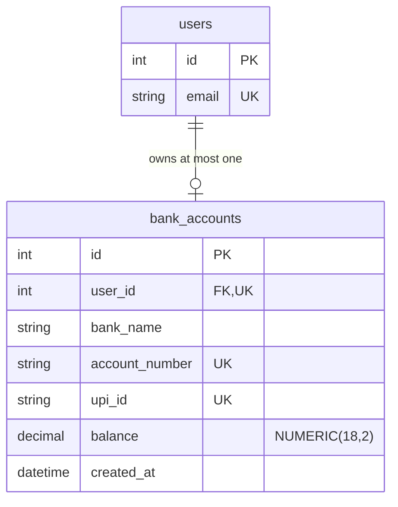

# PayFlow — Phase 3 bank accounts and UPI IDs

PayFlow is a local UPI payment **simulation** for learning. Phase 2 provides
registration → login → JWT access token → protected profile → client-side logout.
Phase 3 adds one fictional bank account and an automatically generated @payflow
identity per authenticated user, starting at **₹0.00 simulated funds**.
There are no real bank connections, real payments, deposits, or transfers.

## Run locally (PowerShell)

Backend, in one terminal:

```powershell
cd D:\PayFLow\backend
docker start payflow-postgres-5436
.\.venv\Scripts\python.exe -m pip install -r requirements-dev.txt
.\.venv\Scripts\python.exe -m alembic upgrade head
.\.venv\Scripts\python.exe -m uvicorn main:app --reload --port 8001
```

Keep your existing `backend/.env` database connection. Local JWT settings were
added without replacing that connection or an existing signing key. The signing
key is random and is never printed by application code.

For a fresh checkout, use `backend/.env.example` as a template and supply your
own database credentials. Generate a key directly into the local `.env` without
printing it (run this **only when configuring a new signing key**):

```powershell
.\.venv\Scripts\python.exe -c "from pathlib import Path; import secrets; p=Path('.env'); f=p.open('a', encoding='utf-8'); f.write('\nJWT_SECRET_KEY='+secrets.token_urlsafe(48)+'\nACCESS_TOKEN_EXPIRE_MINUTES=15\n'); f.close()"
```

Never commit `.env`. Changing a signing key invalidates tokens signed with the
previous key. `ACCESS_TOKEN_EXPIRE_MINUTES` accepts integers from 1 to 60 and
defaults to 15. A missing/short signing key prevents startup instead of silently
using a public default. No table creation, schema changes, data deletion, or
database resets happen at application startup. This project expects the existing
`users` and migrated `bank_accounts` tables.

Frontend, in another terminal:

```powershell
cd D:\PayFLow\frontend
npm install
npm run dev -- --port 5173 --strictPort
```

Open http://localhost:5173. The default API address is http://localhost:8001.
To change it, copy `frontend/.env.example` to `frontend/.env.local`, edit
`VITE_API_BASE_URL`, then restart Vite. `VITE_` settings are public browser
configuration: never put a signing key or database credentials there.

Use Ctrl+C in each terminal to stop its server. If an older server is already
running, stop that server and restart it to load the new dependencies/settings.

## Files and important code

| File | Role and changes |
| --- | --- |
| `backend/main.py` | Preserves registration and health checks. Adds JSON `POST /login`, protected `GET /me`, safe database error responses, and `Cache-Control: no-store` on authentication responses. CORS still permits only the two local Vite origins, now including POST and the Authorization header. |
| `backend/schemas.py` | `LoginRequest` shares email normalization with `RegisterRequest`. Registration keeps its 8–128-character password and trimmed 1–100-character name requirements. Login accepts 1–128 characters so wrong passwords can receive generic credential errors. `TokenResponse` describes the login response. `UserResponse` permits only public profile fields. Extra request fields are rejected. |
| `backend/security.py` | Owns Argon2id hashing, a random dummy hash for unknown-email checks, JWT creation, and the `get_current_user` dependency. `HTTPBearer(auto_error=False)` lets the app return a consistent 401 for missing or invalid authorization. |
| `backend/config.py` | Loads `.env` beside the module, validates the signing key and configured expiry, and keeps the existing DATABASE_URL setting. |
| `backend/requirements.txt` | Adds maintained PyJWT 2.x for JWT signing and verification. |
| `backend/.env.example` | Safe configuration template; has placeholders and no signing secret. |
| `backend/.env` (local only) | Adds a generated key and expiry when absent; keeps the existing database configuration. Ignored by Git. |
| `backend/tests/test_register.py` | Keeps registration coverage, shares its isolated database fixture with auth tests, and checks safe 503 responses for other database constraints. |
| `backend/tests/test_auth.py` | Covers login, generic errors, token issuance, claims, expired/tampered/malformed tokens, missing authorization, profile privacy, nonexistent users, CORS, and safe database failures. |
| `frontend/src/api.ts` | One API base URL and fetch helper. Defines response types, sends JSON/Bearer headers, disables caching, times out requests after 10 seconds, and turns network/API failures into readable messages. |
| `frontend/src/useAuth.ts` | Small React hook holding the token, public user, and expiry **in memory**. Loads `/me` after login, clears sessions on expiry/401, and ignores profile responses from a logged-out session. |
| `frontend/src/App.tsx` | Registration/login forms, confirmation checks, required fields, loading/disabled states, feedback, profile refresh, logout, and the existing backend check. Passwords are read from the form rather than stored in persistent browser storage. |
| `frontend/src/App.css`, `src/index.css` | Responsive interface, shared field/button styling, visible keyboard focus, feedback, and mobile layout. |
| `frontend/index.html` | PayFlow page title and description. |
| `frontend/.env.example` | Public API-address template. |
| `frontend/package.json`, `package-lock.json` | Add the test script and development-only Vitest, Testing Library, and jsdom dependencies. No frontend runtime library was added. |
| `frontend/vitest.config.ts`, `src/test-setup.ts` | DOM test environment and cleanup of rendered components, fetch mocks, spies, and timers between tests. |
| `frontend/src/App.test.tsx` | Exercises registration/login/profile/logout, confirmation, duplicate-email and credential errors, network failure, disabled forms, expiry, rejected tokens, late requests, and losing authentication on page remount. |
| `.gitignore` | Keeps local secrets, virtual environments, caches, dependencies, and generated builds out of source control. Allows `.env.example` templates. |
| `README.md` | This runbook, request-flow explanation, manual checks, test instructions, and limitations. |

The Phase 2 authentication dependencies and `database.py` are reused unchanged.
`models.py` now also defines `BankAccount`; apply migrations before starting the API.

## Phase 3 architecture and file changes



No account status is stored because Phase 3 has no freeze/close/delete actions.
`user_id` references `users.id` with `ON DELETE RESTRICT`; a unique constraint
enforces one account per user even if two requests arrive together. Account
numbers and UPI IDs each have their own unique constraint. Every column is
required. Check constraints restrict banks, account-number and UPI formats,
and finite nonnegative balances. The UPI ID belongs to the account, which belongs
to exactly one user. It is created when that user creates their account.

| New or changed file | Phase 3 purpose |
| --- | --- |
| `backend/models.py` | Adds the `DemoBank` enum, `BankAccount`, named constraints, Decimal balance, and optional `User.bank_account` relationship. No existing user columns are altered. |
| `backend/account_schemas.py` | Accepts only a valid `bank_name`; rejects owner IDs, numbers, UPI IDs, balances, and all other extra fields. Defines safe output and serializes Decimal to exactly two decimal places as a JSON string. |
| `backend/accounts.py` | Small protected router for bank choices, creation, listing, and owner-only detail. Generates identifiers, masks account numbers, and retries uniqueness collisions within savepoints. |
| `backend/main.py` | Includes the account router and marks account responses `Cache-Control: no-store`. Reuses existing authentication, CORS, validation, and safe 503 database handling. |
| `backend/requirements.txt` | Adds Alembic for versioned migrations. |
| `backend/alembic.ini` | Locates migration scripts; contains no credentials or connection URL. |
| `backend/migrations/env.py` | Loads the existing configured database URL and model metadata. Runs transactional online migrations, with a five-second lock timeout for normal CLI use. Accepts a supplied connection for isolated migration tests. |
| `backend/migrations/script.py.mako` | Template for generating future migration revisions. The default downgrade refuses destructive reversal. |
| `backend/migrations/versions/0001_users_baseline.py` | Checks and adopts the pre-Alembic users table without modifying rows. On a fresh database, explicitly creates its Phase 2 schema. Refuses unexpected existing schemas. |
| `backend/migrations/versions/0002_bank_accounts.py` | Creates only the new account table and its constraints; no user data update, table replacement, or deletion. |
| `backend/tests/test_register.py` | Extends the shared isolated SQLite fixture with the account table and enabled foreign-key enforcement. Existing auth/registration tests remain. |
| `backend/tests/test_accounts.py` | Tests auth, ownership, masks, zero balance, exact serialization, bad/extra input, uniqueness, retries, bounds/formats, FK/CHECK/NOT NULL constraints, and safe errors. |
| `backend/tests/test_migrations.py` | Tests fresh upgrades, repeat upgrades, model/migration agreement, and preservation of existing users in temporary transaction-scoped PostgreSQL schemas. |
| `frontend/src/api.ts` | Adds an account response type with `balance: string` and authenticated account/bank API functions using the existing request helper. |
| `frontend/src/AccountPanel.tsx` | Loads the user's account and bank choices; displays loading, retry/error, empty/create, and account-card states. Handles 401 by calling the existing logout mechanism. Ignores responses after logout/unmount. |
| `frontend/src/App.tsx` | Mounts the account panel only for authenticated sessions; logout unmounts it and removes account details. |
| `frontend/src/App.css` | Extends existing styles with responsive account card, bank picker, and profile/dashboard layout. |
| `frontend/src/AccountPanel.test.tsx` | Tests bank choices, loading, empty/display/create states, string precision, failures/retries, disabled submissions, expired sessions, and late responses. |
| `frontend/src/App.test.tsx` | Preserves Phase 2 scenarios with account-aware mocks; adds a check that logout removes the displayed account and UPI ID. |
| `README.md` | Adds Phase 3 architecture, migrations, API usage, design decisions, and verification instructions. |

Credentials, JWT secrets, password behavior, and the memory-only auth hook are
unchanged. No frontend or API dependency was added apart from backend Alembic.

### Apply migrations safely

From `D:\PayFLow\backend`:

```powershell
.\.venv\Scripts\python.exe -m pip install -r requirements-dev.txt
.\.venv\Scripts\python.exe -m alembic current
.\.venv\Scripts\python.exe -m alembic upgrade head
.\.venv\Scripts\python.exe -m alembic current
.\.venv\Scripts\python.exe -m alembic check
```

The expected head is `0002_bank_accounts`. The implementation already applied
these migrations to the configured local database and verified the existing
user was preserved. Repeating `upgrade head` is a no-op.

No manual `stamp`, database reset, or `Base.metadata.create_all()` is required.
The baseline inspects an existing users table; online migration is intentional
and offline SQL generation is disabled. Both revisions refuse downgrades rather
than dropping user/account data. Changes should use reviewed forward migrations.
If a table differs unexpectedly or a lock cannot be acquired, migration fails
instead of silently modifying/replacing it. Migration files freeze their original
schema; change banks or constraints later through a new revision.

To create a future revision after deliberately changing models:

```powershell
.\.venv\Scripts\python.exe -m alembic revision --autogenerate -m "describe the change"
```

Review generated SQL/schema changes before applying them, especially any removal.

### Account creation and UPI generation

1. React fetches `GET /accounts` and `GET /accounts/banks` with the existing
   Bearer token. The server is the source of truth for bank choices.
2. The user chooses **Grove Demo Bank**, **Orbit Demo Bank**, or **River Demo Bank**.
   React sends only `{ "bank_name": "Grove Demo Bank" }` to `POST /accounts`.
3. `get_current_user` validates the JWT and loads its user. The backend derives
   ownership from that user; the client cannot nominate another owner.
4. The server creates a number with `SIM` plus 16 cryptographically random digits.
   It builds a safe lowercase ASCII name slug (fallback `learner`) plus a random
   12-hex-character suffix and `@payflow`. For example,
   `harsh-kumar-a1b2c3d4e5f6@payflow`. Users cannot claim an arbitrary address.
5. The server sets `Decimal("0.00")` regardless of client wishes. The database
   also supplies a zero default for inserts that omit the balance.
6. A savepoint encloses each attempted insert. A number/UPI uniqueness collision
   rolls back that attempt and generates fresh identifiers, up to five attempts.
   A duplicate-owner constraint returns 409. Other database errors use the
   existing safe 503 handler. On success the session commits the single account.
7. Only masked account numbers are returned. The UI shows the exact balance,
   bank name, masked number, and sandbox-only UPI ID. No funds can be added or sent.

`NUMERIC(18,2)` stores up to 16 whole-number digits and two fractional digits.
Python `Decimal` avoids binary floating-point rounding (such as in `0.1 + 0.2`).
The API emits `"0.00"`, not `0.0`. React keeps the balance as a string and never
uses `Number` or `parseFloat` to display it. All balances in this phase use the
single simulated INR denomination; there is no currency-conversion feature.

### Phase 3 API examples and manual checks

Use http://localhost:8001/docs. Register/login as described below, then click
**Authorize** and enter only the JWT value.

| Endpoint | Expected result |
| --- | --- |
| `GET /accounts/banks` | 200; predefined fictional bank names. |
| `GET /accounts` | 200; `[]` before creation, otherwise only the signed-in user's account. |
| `POST /accounts` | 201 with the account; 409 if this user already has one. |
| `GET /accounts/{account_id}` | 200 for the owner; 404 for missing or another user's account. |

Creation request:

```json
{ "bank_name": "Grove Demo Bank" }
```

Illustrative response (IDs/timestamps/identifiers will differ):

```json
{
  "id": 1,
  "bank_name": "Grove Demo Bank",
  "masked_account_number": "SIM •••• •••• •••• 1234",
  "upi_id": "harsh-kumar-a1b2c3d4e5f6@payflow",
  "balance": "0.00",
  "created_at": "2026-11-03T12:00:00Z"
}
```

Check these behaviors:

1. With no authorization, account endpoints return 401.
2. An unused user sees an empty account list. Create one account and verify the
   balance is the JSON **string** `"0.00"`; the full account number is absent.
3. Repeat creation: expect 409 and still exactly one account.
4. Choose an unlisted bank or include `balance`, `user_id`, `account_number`, or
   `upi_id` in the request: expect 422, without creating anything.
5. Sign in as a different test user and request the first account's ID: expect
   404. Its list remains empty until it creates its own account.
6. In React, sign in and choose a demo bank. Submit once, inspect the card, refresh
   accounts, then log out: account details disappear. Sign in again to retrieve
   the same persisted account. Browser refresh still signs out as in Phase 2.
7. Test phone width, account-loading failures, and retry using Refresh accounts.
   A timed-out creation may still have committed on the server; refresh before
   retrying. The database unique constraint prevents a second account.

Manual creation saves fictional records in the development database. Do not
delete those records or reset volumes as part of these checks.

### Next phase

Phase 4 can add simulated transfers and transaction records with atomic debits
and credits, concurrency control, and idempotency. None are implemented here.
Account balances cannot be topped up through Phase 3 APIs or UI. Real UPI
networks and real banking remain outside this learning project.

## How requests work

### Registration

1. React checks confirmation, required fields, email syntax, and length limits.
   Browser checks improve usability; backend validation is authoritative.
2. `registerUser()` sends JSON to `POST /register`.
3. Pydantic validates fields, trims the name, and lowercases the normalized email.
4. `Depends(get_db)` supplies a SQLAlchemy session. A parameterized `SELECT`
   checks the normalized email. An existing email returns 409.
5. Argon2id generates a salted password hash. Only that hash is assigned to the
   existing `User.password_hash` column.
6. `db.add()` stages the insert; `db.commit()` writes it to PostgreSQL through
   SQLAlchemy and psycopg. `db.refresh()` loads the generated ID/timestamp.
7. `response_model=UserResponse` filters out the password hash. React displays
   success and switches to login; registration does not sign in automatically.

Two requests may both pass the initial email lookup. The existing database unique
constraint remains the final safeguard. A PostgreSQL uniqueness error triggers
`db.rollback()` and a 409. Other SQLAlchemy failures become a generic 503 rather
than returning SQL, connection strings, or exception details. Validation errors
omit submitted values, including passwords and malformed JSON bodies.

### Login and password verification

1. React sends `{ "email": "...", "password": "..." }` to `POST /login`.
2. The backend normalizes the email and reads the corresponding `User`.
3. `password_hasher.verify()` checks the submitted password against the stored
   Argon2id hash. It does not decrypt the stored value. For an unknown email, a
   dummy verification reduces timing differences.
4. Unknown emails and incorrect passwords both return 401 with
   `Invalid email or password`. No password/hash is returned.
5. A valid login returns `access_token`, `token_type: "bearer"`, and
   `expires_in` in seconds. This login response necessarily contains the token;
   it must not be logged, copied into URLs, or displayed in the application UI.

### JWT creation and protected profile

The server signs with HS256 and `JWT_SECRET_KEY`. Tokens contain the stable user
ID as string `sub`, issue time `iat`, expiry `exp`, issuer `iss`, audience `aud`,
and `token_use: "access"`. They contain no name, email, or password. A JWT is
signed, not encrypted: anyone holding it can read its claims.

After login, React calls `GET /me` using `Authorization: Bearer <access_token>`.
`get_current_user()` verifies the signature with a fixed algorithm allowlist,
expiry, required claims, issuer, audience, token purpose, and valid database ID.
It then reads that user from PostgreSQL and returns public fields. Missing,
expired, tampered, malformed, or unknown-user tokens return 401 with a Bearer
challenge. The dependency checks the database on every profile request rather
than trusting token claims as current user data.

### Authentication state and logout

`useAuth()` stores the token only in React memory. The UI shows a profile only
after `/me` succeeds. Refreshing or closing the page loses authentication. There
is no localStorage, sessionStorage, token cookie, or token in the URL.

The Log out button clears local session state and user details. A late profile
request cannot restore a logged-out session. A timer signs out at the configured
expiry; a 401 from `/me` also clears authentication.

**Client-side logout does not revoke the JWT on the server.** A previously copied
token remains usable until it expires. There is deliberately no misleading
server logout endpoint, refresh token, or production session system in Phase 2.
Memory storage reduces persistence after navigation but does not prevent active
XSS from accessing a running application's credentials.

## Test each endpoint through FastAPI /docs

Open http://localhost:8001/docs with the backend and database running.

1. Expand `GET /health` → **Try it out** → **Execute**: expect 200/healthy.
2. Execute `GET /db-health`: expect 200/connected.
3. Expand `POST /register` and submit a fresh email:

   ```json
   {
     "full_name": "Harsh Kumar",
     "email": "harsh@example.com",
     "password": "Learning-PayFlow-2026!"
   }
   ```

   Expect **201** and only `id`, `full_name`, `email`, `created_at`.
   Repeat it (including a differently capitalized email): expect **409**.
   Try a blank name, bad email, or password shorter than 8: expect **422**.
4. Expand `POST /login` and submit the same email/password, without full_name:

   ```json
   { "email": "harsh@example.com", "password": "Learning-PayFlow-2026!" }
   ```

   Expect **200** and a Bearer access token. A wrong password/unknown email
   returns **401** with the same generic message.
5. Before authorizing, execute `GET /me`: expect **401**.
6. Click **Authorize** in the docs. Paste only the access-token value into the
   HTTPBearer field (the docs add `Bearer`), then authorize and close the dialog.
   Execute `GET /me`: expect **200** and the public profile.
7. Replace the token with `invalid-token`: expect **401**. For expiry, temporarily
   configure `ACCESS_TOKEN_EXPIRE_MINUTES=1`, restart the backend, log in again,
   wait over a minute, and call `/me`: expect **401**. Restore 15 afterward.
8. Use the docs' **Authorize → Logout** action to clear its saved authorization.
   This changes only the docs browser state and does not revoke the token.

Successful manual registrations create real local user rows. These instructions
do not delete them. Swagger's token display is a developer tool; treat it as
sensitive and avoid sharing screenshots of login responses.

## Test the frontend manually

1. Open http://localhost:5173 and choose **Create account**.
2. Submit mismatched passwords: an error appears without making a registration
   request. Correct them and use a fresh email: success switches to sign in.
3. Try a wrong password: a generic error appears. Sign in correctly: the profile
   shows name, email, ID, and membership date.
4. Click **Refresh profile**: a protected `/me` request appears in the browser's
   Network panel with its Bearer header. Do not share that header.
5. Click **Log out**: the profile disappears. Reload while logged in: the login
   form returns because tokens are in memory only.
6. Check the layout at phone width. Use the keyboard to navigate form fields.
7. Stop the backend and submit a form: readable feedback appears and the form
   becomes available again. Restart the backend to continue.
8. **Check Backend** still calls `/health` and shows backend connectivity.

## Automated tests

From `D:\PayFLow\backend`:

```powershell
.\.venv\Scripts\python.exe -B -m unittest discover -s tests -v
```

The default suite creates isolated in-memory SQLite databases. Five PostgreSQL-only
tests (migration, regex/NaN checks, and uniqueness-race checks) are skipped in this mode.

To run the full suite against the configured PostgreSQL database:

```powershell
$env:REGISTER_TEST_POSTGRES = '1'
.\.venv\Scripts\python.exe -B -m unittest discover -s tests -v
Remove-Item Env:REGISTER_TEST_POSTGRES
```

Each PostgreSQL test owns an outer transaction and uses session savepoints. Test
inserts/updates are rolled back; no existing users are deleted, reset, or committed
over. PostgreSQL sequences can still advance during rolled-back inserts, so gaps
in user IDs are normal. No tables/containers/volumes are dropped.

From `D:\PayFLow\frontend`:

```powershell
npm test
npm run build
npm run lint
```

React tests mock fetch and exercise real forms/state; they never access your
database. `npm run build` runs TypeScript checks before creating the production
bundle. No test prints live credentials or tokens.

Executed for Phase 3: **39 PostgreSQL backend tests passed** (including all Phase 2
tests), **22 frontend tests passed**, production build/type checks passed, ESLint
passed, and Alembic reported no model/schema differences. Default SQLite mode
passed 34 tests with the five PostgreSQL-only tests skipped. The saved counts
remained **1 user and 0 accounts**; existing user credentials were preserved.

A real Chromium browser also completed registration → invalid login → valid
login → protected profile → refresh → logout → reload against a temporary API
using an outer PostgreSQL transaction. Confirmation validation, memory-only
storage, mobile overflow, and the backend-check button passed with no page errors.
The temporary API and frontend servers were stopped afterward; test user rows
were not saved. Desktop and phone layouts were visually inspected.

For Phase 3, the real-browser check additionally passed empty-state loading,
bank selection, account creation, exact `"0.00"` serialization, masked output,
UPI format, duplicate rejection, cross-user 404/empty-list protection, account
refresh, logout, and re-login retrieval of the same account. Phone layout had
no horizontal overflow and Chromium reported no page errors. This check used
the same outer-transaction strategy; its users and accounts were not saved.

## Local-development security limits

- Use HTTPS in production; localhost HTTP is acceptable only for local work.
- CORS remains restricted to `http://localhost:5173` and
  `http://127.0.0.1:5173`. CORS is a browser policy, not authentication.
- Short-lived tokens limit exposure, but there is no revocation list, refresh
  token, multi-device session management, or server-side logout.
- There is no login throttling, abuse protection, email verification, recovery,
  or MFA. Add those before any public deployment. Registration's explicit 409
  also reveals whether an email is registered, as requested for this exercise.
- Never log passwords, hashes, Authorization headers, or login responses.
  Production monitoring must redact them, including database error parameters.
- The local `.env` is ignored, but environment files still require appropriate
  filesystem access controls. Use a managed secret store for deployment.
- The existing ESLint dependency chain reports 12 moderate development-only
  audit warnings. The production dependency audit reports 0 vulnerabilities.
  No forced/breaking dependency downgrade was applied. Starlette currently emits
  an httpx TestClient deprecation warning; the tests still pass.
- Future security work includes rate limits, verified email, and a reviewed
  session strategy. There are no real payments or real banking integrations.

References: [FastAPI password hashing and JWT tutorial](https://fastapi.tiangolo.com/tutorial/security/oauth2-jwt/)
and [PyJWT claim verification](https://pyjwt.readthedocs.io/en/stable/usage.html).
Phase 3 references: [Alembic migrations](https://alembic.sqlalchemy.org/en/latest/tutorial.html),
[SQLAlchemy constraints](https://docs.sqlalchemy.org/en/20/core/constraints.html),
and [Pydantic decimal serialization](https://docs.pydantic.dev/latest/api/standard_library_types/#decimals).
