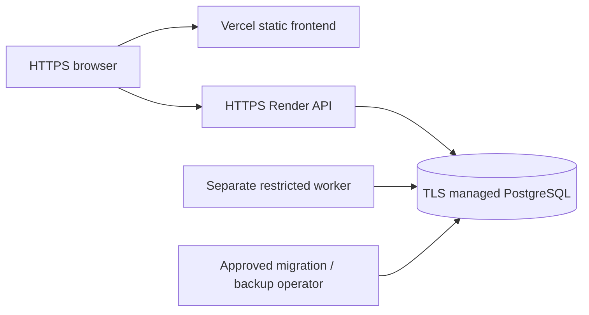

# Deployment and operations

**Status: prepared and locally verified, not publicly deployed.** No cloud resources, remote releases, registry pushes or public URLs were created. All funds, bank identities, recharges and bills remain fictional. Obtain explicit approval for hosting costs and public exposure before following the cloud release steps.

## Local isolated Docker stack

Prerequisites: Docker Desktop/Linux containers, Docker Compose supporting health/one-shot dependencies, Python 3.11, Node 22 and PowerShell. The existing `payflow-postgres-5436` container is not part of this stack and must not be stopped, reset, renamed or have its volume removed.

From the repository root:

```powershell
python tools/init_compose.py
docker compose --env-file .env.compose config --quiet
docker compose --env-file .env.compose up -d --build --wait
```

The initializer creates a **new** ignored `.env.compose` with random credentials and refuses to overwrite an existing file. Preserve that file for the existing volume: changing its passwords does not rotate database roles automatically. Review Windows file ACLs; POSIX creation uses owner-only permissions. Never paste `docker compose config` output containing interpolated credentials into logs; use `--quiet`.

Open [the local simulated demo](http://localhost:18080). Only the frontend proxy is bound to loopback. PostgreSQL, API and worker have no published host ports. The project is `payflow-demo`, volume `payflow_demo_pgdata`; neither collides with the original development database. Changing the local HTTP port requires updating `.env.compose`, and the corresponding generated CORS origins follow it.

| Service | Responsibility |
| --- | --- |
| `postgres` | Separate PostgreSQL 16 with persistent named volume and first-volume-only role provisioning. |
| `migrate` | One-shot, explicit expected-revision upgrade/check and local role grants; API/worker wait for success. |
| `api` | Non-root FastAPI on private port 8001, bounded pool, no reload or raw URL access logs. |
| `worker` | Same non-root backend image, separate process/DB role, expiring leases and local heartbeat probe. |
| `frontend` | Multi-stage Vite bundle served by unprivileged Nginx on 8080, `/api` proxy, static security headers. |

Application containers use read-only filesystems, bounded `/tmp`, dropped capabilities and no-new-privileges. Backend runtime dependencies are exact/hash-checked; `npm ci` uses the committed lock. Base images are digest-pinned. This improves reproducibility, not a guarantee that dependencies or operating-system packages remain vulnerability-free; refresh/review digests and advisories regularly.

```powershell
docker compose --env-file .env.compose ps -a
docker compose --env-file .env.compose logs --tail 50 api worker migrate
docker compose --env-file .env.compose exec api python -m reconcile
python tools/deployment_smoke.py
```

The smoke tool verifies container labels, the loopback frontend binding and the `payflow_demo` database before writing. It creates only synthetic accounts in this separate dataset and checks PIN enforcement, authorization, funding limits, transfers/replays, requests/splits, self-transfers, authoritative service prices, receipts, balances, history, notifications, non-root users and worker privileges. It cannot target a public deployment or the development API. Each run creates new disposable demo identities; do not describe those records as real service activity.

Stop only this project's services without removing data:

```powershell
docker compose --env-file .env.compose stop
```

Do not use volume-removal/reset commands. A stopped worker's committed events remain durable. Restart using `docker compose --env-file .env.compose up -d --wait`.

## Configuration and permissions

`PAYFLOW_ENV` is `development`, `test` or `demo`. Demo startup rejects non-HTTPS/wildcard CORS origins and database URLs without `sslmode=require`, `verify-ca` or `verify-full`. Prefer certificate verification with the provider's CA where supported. Provider `postgres://` / `postgresql://` URLs are normalized to synchronous psycopg. SQLite is not a deployment option.

| Variable | Deployment use |
| --- | --- |
| `DATABASE_URL` | Runtime role's managed PostgreSQL URL, with required TLS; never a frontend value. |
| `JWT_SECRET_KEY` | Stable random 32+ byte API signing secret; identical across API instances. Preserve it across releases unless deliberately rotating sessions. |
| `CORS_ALLOWED_ORIGINS` | Comma-separated exact approved frontend HTTPS origins; no wildcard preview domains. |
| `PAYFLOW_EXPOSE_DOCS` | Defaults off in demo; explicitly enable only if desired. No credentials are embedded in documentation. |
| `LOG_LEVEL` | INFO/WARNING/ERROR; structured logs exclude bodies, credentials and raw URLs. |
| `PORT`, `WEB_CONCURRENCY`, `PAYFLOW_MAX_CONCURRENCY` | Container/cloud listener, process count and per-process concurrency cap; defaults 8001/1/16. Size memory for concurrent Argon2 work. |
| `DB_POOL_*`, `DB_MAX_OVERFLOW`, `DB_*TIMEOUT*` | Connection budget and bounded waits; each API/worker process owns a pool. |
| `PAYFLOW_OPS_TOKEN` | Optional independent operator token. Empty disables `/metrics`; keep it off public networks. |
| `OUTBOX_*`, `WORKER_HEARTBEAT_FILE` | Bounded worker polling/leases/retries; container probe checks an atomically updated local heartbeat. |
| `VITE_API_BASE_URL` | Public build-time URL only. Docker uses `/api`; hosted Vercel builds require an external HTTPS API URL without credentials, query or fragment. Rebuild after changing it. |

The local database has separate owner, API and worker roles. The API cannot update/delete immutable payment/journal records or alter migration versions. The worker can read only required payment/account columns and update delivery state/insert notifications; it cannot debit accounts, insert payments or update balances. The worker's configuration key is independent from API JWT signing authority. It is required by shared configuration imports but never signs application sessions.

Cloud roles must be provisioned and reviewed separately using the provider's permitted administration mechanism. Do not give the runtime or worker a database-owner credential merely to simplify deployment. The API role can access multiple users' records internally; object ownership is enforced in backend services rather than PostgreSQL row-level security. A compromised API credential is still a serious incident.

## Controlled migrations and rollback

No new business schema revision was required for this infrastructure work; head remains `0009_reliability_outbox`. `python -m migrate` verifies revision/metadata without upgrading. API and worker startup never migrate automatically.

Before any release upgrade: identify the intended environment, take/verify a backup, review the migration SQL and expected current revision, and schedule maintenance if compatibility demands it. In an operator environment with the **owner** connection (not deployed API credentials):

```powershell
Set-Location backend
.\.venv\Scripts\python.exe -m migrate --apply --expected-current YOUR_VERIFIED_CURRENT_REVISION
.\.venv\Scripts\python.exe -m reconcile
```

Use `base` only for a verified new empty database. A session advisory lock serializes runners across commits; a second runner fails safely. Unexpected current revisions fail before an upgrade. Already-current reruns are idempotent. Plain online Alembic CLI migration runs also acquire the lock. Isolated tests supplying their own schema connections are intentionally separate.

Compose runs its controlled one-shot upgrade before dependent services; future upgrades require updating `MIGRATION_EXPECTED_REVISION` only after backup/review. Render's prepared pre-deploy command performs **verification only**. Run approved owner migrations separately before manually releasing code that requires them. Expand/contract changes should keep old instances compatible during rolling deployments. The exact-head readiness policy must be reviewed for every future schema rollout; do not promise zero downtime for incompatible DDL.

Rollback application code only if it is compatible with the current schema and pending event versions. Do not run destructive Alembic downgrades or erase committed payments. Recover a failed upgrade through a reviewed forward migration or restore into a new isolated database, reconcile it, then approve cutover. Never restore over the current database as an automatic rollback.

## Hosting recommendation and release gate

Recommended initial topology is Vercel static frontend plus a Render container web service, separate Render background worker and persistent paid managed PostgreSQL in one selected region. It fits the existing synchronous PostgreSQL transaction model without Redis/Kafka. Render supports Docker and separate workers; its blueprint allows disabling automatic deployment and paid pre-deploy checks. See [Docker support](https://render.com/docs/docker), [blueprint configuration](https://render.com/docs/blueprint-spec) and [compute plans](https://render.com/docs/compute-plans).

As checked on 6 November 2026, Render lists a 2 GiB web instance at approximately $25/month, a small 512 MiB worker at $7/month, and entry paid PostgreSQL at $6/month: **roughly $38/month before storage, workspace, bandwidth, tax and other usage**. This is a planning estimate, not a quote or a measured capacity commitment. Smaller web instances cost less but need a deliberate Argon2 memory/concurrency budget. Verify current checkout pricing before approval. [Official pricing](https://render.com/pricing), [provider cost example](https://render.com/articles/production-rails-hosting-guide).

Do not use expiring free PostgreSQL for retained demo data: Render's current free database expires after 30 days. Vercel Hobby currently restricts usage to personal, non-commercial projects and has quotas; confirm portfolio eligibility or select an appropriate paid plan. [Render free limits](https://render.com/docs/free), [Vercel Hobby terms](https://vercel.com/docs/plans/hobby). Availability, backup retention and regional capacity remain subject to provider confirmation; no cloud account was accessed.



### User actions required before a public release

1. Explicitly approve provider, region, budget, public exposure and data-retention policy. No paid resources have been created.
2. Create a separate persistent managed PostgreSQL demo database. Configure network restrictions/TLS, backup retention and owner/runtime/worker roles. Do not migrate the development dataset into public hosting by default.
3. Back up and apply approved migrations with the owner credential. Grant reviewed runtime/worker permissions. Keep owner credentials out of service environments.
4. After approval, create services from `render.yaml` (or equivalent dashboard settings). The file deliberately creates no database and turns auto-deploy off. Set API and worker `DATABASE_URL` separately, exact frontend origin, stable API JWT secret and independent worker key. Keep metrics disabled unless restricted monitoring is ready.
5. Create a Vercel project with root `frontend`, set the approved API HTTPS URL in `VITE_API_BASE_URL`, and keep Git automatic deployment disabled as prepared in `vercel.json`. A manual public deployment itself requires approval. No placeholder hostname is a deployed URL.
6. Manually deploy API and worker after migration verification, then frontend. Confirm actual HTTPS URLs, CORS, readiness, worker progress and provider shutdown behavior. Choose trusted-proxy handling only after verifying ingress/forwarded-header guarantees; current server ignores forwarding headers. Proxy-shared IP rate budgets may constrain a public demo but identity/user limits remain enforced.
7. Run the [non-destructive post-deployment checklist](deployment-smoke.md) with authorized disposable demo accounts. Record actual URLs/results. Do not run local fixture/load scripts against public traffic.

The blueprint is locally parsed/prepared, not applied or authenticated against a cloud account. GitHub Actions validates/builds only and has no cloud credentials, registry publishing or deployment permission. Enable branch protection and require these checks after you review and push the changes yourself.

## Monitoring and troubleshooting

- Probe `/health/live` for process responsiveness and `/health/ready` for database/revision readiness. Never publish PostgreSQL or database-admin interfaces.
- Use JSON request/correlation logs; do not upload environment dumps, SQL parameters, JWTs, PINs, backup files or raw browser network traces.
- `/metrics` requires `X-Ops-Token`; use private monitoring/TLS. Per-process HTTP metrics need per-instance scraping; do not sum duplicated database gauges.
- Docker worker health uses a local monotonic heartbeat; monitor outbox age/dead letters separately. A stopped or delayed worker does not make a committed payment fail.
- 503 readiness: check database reachability/TLS, expected revision, privileges and pool budget. Do not reset the database. Inspect a failed `migrate` service before starting dependents.
- Unknown payment outcome: retry the original key; check the receipt/history. Never create a replacement payment merely because a response or activity event is late.
- Outbox backlog/dead letters: inspect `python -m outbox_worker --inspect-dead`, fix the cause and review replay with the same event ID. Never debit again to repair notification delivery.
- Run `python -m reconcile` in an authorized operator context. It reports problems and never repairs balances automatically.

See [backup/recovery](backup-recovery.md) and [testing/CI](testing.md). Remaining work includes real cloud verification, automated provider alerts, restore/cutover drills, container OS vulnerability scanning, trusted ingress review and periodic dependency/base-image maintenance. This is a simulated portfolio service, not certified or production-secure financial infrastructure.
