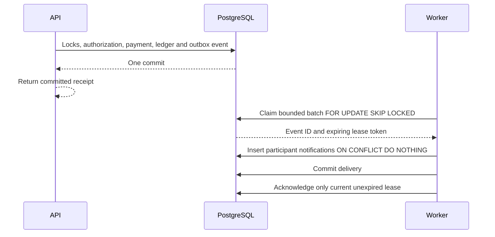

# Reliability and operations

PayFlow keeps authoritative fictional money in one PostgreSQL transaction. This document separates implemented controls from capacity proposals; no high-scale throughput is claimed.

## Architecture audit

| Classification | Finding and action |
| --- | --- |
| Implement now | No durable non-financial delivery: add a transactional outbox and leased worker. No readiness/structured telemetry: add probes, correlation logs and protected metrics. Implicit pool sizing: make per-process budgets and database waits explicit. |
| Implement now | Daily counters unnecessarily rescan history on every posting: initialize only when absent, under the existing owner lock. Risk checks hydrate payment/account ORM graphs: replace with bounded-result SQL aggregates. Bill lists query current date for every item: evaluate once per page. |
| Measured query change | A 20,000-row isolated actor/time query changed from sequential scan (4.319 ms) to index-only scan (0.101 ms). Add `(actor_user_id, created_at)`; preserve existing indexes and include write/storage cost in later benchmarks. See recorded JSON plans. |
| Benchmark before changing | Deferred cached-bank-balance checks aggregate an account's journal history, Argon2 approval consumes CPU, sender locks serialize same-user activity, recipient rows can be hot, and synchronous audit/rate writes add WAL. Internal settlement has no mutable bank-balance row, though shared journal indexes still concentrate writes. Do not remove accounting guarantees to improve a benchmark. |
| Future design only | Settlement lanes, ledger partitioning, distributed streaming, replicas, and account-based sharding. See [scaling design](scaling-to-1m-tpm.md). |

Existing history endpoints use stable cursors and bounded pages; recent contacts uses a grouped join rather than one query per contact. Split detail uses bounded participants, though loading attempts/history still adds queries. Payment relationships use select-in loading. These are not proofs of constant query cost or high throughput. Reconciliation intentionally scans financial history and belongs off the request path.

## Atomic outbox and delivery



`0009_reliability_outbox` adds `outbox_events` and `activity_notifications`, a measured payment index, event-identity immutability and a deferred trigger requiring an event for each **new** successful payment. It does not backfill or rewrite historical payments. Events contain a version and payment UUID only, plus optional correlation UUID. They contain no names, notes, references, balances, PINs or tokens.

The event is created inside the existing posting transaction for direct/QR/request/split/self/service/funding success. Replays return cached results without creating another event. Failed payments create no success event. Worker failure cannot change a successful payment or its receipt.

Delivery is **at least once**. A stable event ID and `(event_id, user_id)` uniqueness make this local notification consumer idempotent. Delivery commits before acknowledgment deliberately: a crash between them redelivers without duplicating a notification. This is not a claim of exactly-once external messaging. A future external consumer must persist its own deduplication key and handle its external side effect safely.

Claims use a random fencing token and deadline. Expired claims are reclaimed; stale workers cannot deliver/acknowledge a new lease. Delivery locks the claim row for the short local insert transaction. There is no external network call inside financial or notification transactions. Batches default to 10, leases 30 seconds, polling one second, and maximum attempts five. Transient retries wait `min(300, 2 ** attempt_count)` seconds; malformed events dead-letter immediately. Expiring the final attempt also dead-letters. No jitter is currently implemented.

Lease expiry is rechecked **after** acquiring the claim row lock, including when a worker waited past its deadline. PostgreSQL documents `SKIP LOCKED` as appropriate for queue-like consumers, with an inconsistent view unsuitable for ordinary authoritative reads; PayFlow uses it only for event claims, never to skip financial account locks. See the [PostgreSQL 16 locking reference](https://www.postgresql.org/docs/16/sql-select.html).

Dead letters remain durable for operator investigation; there is no automatic deletion or blind replay command. Fix the consumer and design a reviewed replay using the same event ID. Do not manually construct another payment. SIGINT/SIGTERM stops polling, finishes the current item and leaves other claims recoverable by lease expiry.

## Running API instances and workers

From `backend`, after applying migrations:

```powershell
.\.venv\Scripts\python.exe -m uvicorn main:app --host 127.0.0.1 --port 8001 --workers 2 --no-proxy-headers --no-access-log
```

Run one or more separate worker terminals:

```powershell
.\.venv\Scripts\python.exe -m outbox_worker
# Read-only bounded inspection:
.\.venv\Scripts\python.exe -m outbox_worker --inspect-dead
# One bounded poll/batch, useful for smoke verification:
.\.venv\Scripts\python.exe -m outbox_worker --once
```

There is no API-local background delivery thread, broker, Redis or Celery dependency. Rate limits, PIN grants, counters, idempotency, claims and financial state are PostgreSQL-backed. All API instances must use the same database and JWT/security configuration. An outage fails closed for financial/security operations. Per-process telemetry is non-authoritative.

Default per-process API pool budget is `DB_POOL_SIZE=5`, `DB_MAX_OVERFLOW=5`, timeout five seconds, recycle 1800 seconds and pre-ping. With N API processes and M standard workers, the worst configured application budget is `(N + M) * (pool_size + max_overflow)`, plus migrations, monitoring and operators. The existing local PostgreSQL maximum is 100 connections; reserve headroom. Workers use the same configurable engine budget, though the current loop processes one item at a time. Pooling is not a throughput guarantee. Readiness can wait for pool checkout plus its bounded query, not a hard two-second wall-clock SLA.

Connections use five-second connect/lock timeouts, a 15-second statement timeout and a 30-second idle-in-transaction timeout. Posting applies configured statement/lock limits locally as well. Timeouts, deadlocks and uncertain commits return safe failure/recovery responses; the server does not silently invent a new payment key or automatically retry financial operations. No isolation or lock order was weakened.

The API lifespan disposes its own pool on graceful shutdown. Uvicorn drains active requests; abrupt termination relies on PostgreSQL rollback or committed idempotency recovery. Test fixture engines and migrations are separate from runtime pools.

Use distinct least-privilege database roles before deployment. A worker needs event SELECT/UPDATE, notification INSERT/SELECT, and minimal participant/payment reads; it should not have UPDATE/INSERT privileges on balances, payments or ledger tables. This repository does **not** provision those roles or claim that using a shared development superuser enforces them.

## Probes, logs and metrics

- `GET /health/live`: process responsiveness, no database dependency.
- `GET /health/ready`: bounded database query and exact expected Alembic revision; 503 while unavailable/unmigrated. Legacy `/health` and `/db-health` remain compatible.
- `GET /activity/notifications`: JWT-protected, owner-only stable cursor pagination, payment references only. Delay here is not payment failure; use the existing receipt/history for financial truth.
- `GET /metrics`: disabled unless `PAYFLOW_OPS_TOKEN` has at least 32 bytes; supply it as `X-Ops-Token`. Not a user JWT. Keep the endpoint on a restricted network/TLS, never put the token in a URL or frontend variable.

JSON logs include UTC timestamp, service, safe event, route template, method/status, duration and validated UUID request/correlation IDs. Headers return `X-Request-ID` and `X-Correlation-ID`. Payment and worker records correlate via the persisted outbox correlation. Raw URLs/query strings, payloads, credentials, SQL errors and exception bodies are excluded. Use `--no-access-log` to avoid Uvicorn's separate raw-URL log; deployment/proxy logging still needs review. Client correlation IDs are untrusted tracing metadata, not authorization. Unknown/malformed IDs become fresh UUIDs.

Metrics include HTTP counts/duration histograms, new payment outcomes, replays/conflicts, transaction errors, fraud blocks, pool checkout/size/overflow, outbox state/dead count/oldest lag/durable attempts, database connections, lock waiters and deadlocks. Request and operation labels are bounded route/enums; IDs and personal data are never labels. There is no database CPU metric: collect it externally, e.g. bounded `docker stats`, and PostgreSQL profiling tools.

HTTP/payment counters are **per process and reset on restart**. Prefer one API process per independently scraped instance. Scraping a shared port with multiple Uvicorn workers does not aggregate their counters. Worker attempt/dead-letter/backlog gauges come from PostgreSQL and must not be summed across duplicate database scrapes. Metrics queries can scan growing event history; they have a two-second statement timeout but need cached/aggregate exporters at larger scale. A telemetry scrape is not the authoritative payment count.

Example PromQL (with an external Prometheus installation; no bundled Grafana stack):

```promql
sum(rate(payflow_http_requests_total[5m]))
histogram_quantile(0.95, sum by (le) (rate(payflow_http_duration_seconds_bucket[5m])))
sum(rate(payflow_idempotency_total{outcome="REPLAY"}[5m]))
max(payflow_outbox_oldest_seconds)
max(payflow_outbox_events{state="DEAD"})
```

Alert on ready failures, error/latency changes, connection saturation, lock waits/deadlocks, queue age and dead letters. No actual alerting service is installed.

## Implementation map

| Files | Purpose |
| --- | --- |
| `backend/outbox_models.py`, `migrations/versions/0009_reliability_outbox.py`, `migrations/env.py` | Durable events/notifications, lease/identity constraints, same-transaction event guard, and measured actor/time index. |
| `backend/outbox.py`, `outbox_worker.py` | Atomic enqueue, bounded leased claims, idempotent local delivery, fencing, retries, shutdown and dead-letter inspection. |
| `backend/reliability_config.py`, `database.py`, `.env.example` | Validated pool/wait/worker settings and opt-in operator credential. |
| `backend/operations.py`, `observability.py`, `main.py` | Live/ready probes, restricted metrics, private activity, JSON correlation logs and lifespan cleanup. |
| `backend/payments.py`, `payment_models.py`, `payment_policy.py`, `commerce.py`, `reconcile.py` | Shared-engine event/telemetry integration, replay headers, measured index, aggregate/query reductions and event-link reconciliation. |
| `backend/tests/test_reliability.py`, `test_migrations.py`, `payment_support.py` | Failure/concurrency tests, additive migration preservation, and selectable validated isolated databases. |
| `backend/benchmarks/*`, `requirements-benchmark.txt` | Isolated real-PIN ASGI/HTTP fixtures, optional Locust workloads, bounded runner, query plans and actual result artifacts. |
| `frontend/src/api.ts`, `PaymentPanel.tsx`, `Reliability.test.ts`, `frontend/qa/isolated_backend.py` | Full-response timeout/cancellation recovery, delayed-activity wording, behavior tests and isolated browser fixture configuration. |
| `README.md`, `docs/reliability.md`, `performance.md`, `scaling-to-1m-tpm.md` | Runbooks, measured findings, implementation limits and future scaling proposals. |

## Failure verification and frontend recovery

Tests inject failure before posting commit and after commit/before response, simulate worker death after claim/delivery, race workers, fence stale leases, exhaust a separate one-connection test pool, cancel a `pg_sleep` with a test-only timeout, and verify database-unavailable probes. Existing tests cover concurrent source/self/bill/request payments, limits, rollbacks, changed-payload keys and reconciliation. These are deterministic boundary simulations, not power-loss, machine-crash or production process-kill certification.

React preserves the original pending operation/key without PIN/JWT/grant storage. Fetch and response-body interruption become an uncertain outcome; the ten-second request bound also honors caller cancellation. There is no automatic POST retry. Recovery uses the original key and existing committed receipt, requesting a fresh bound PIN grant only when the server establishes authorization is required. Receipts explicitly remain valid when asynchronous activity is delayed.

Run tests using the README commands; `PAYFLOW_TEST_DATABASE=payflow_reliability_tests` selects another validated isolated test database without resetting any existing database. Test schemas remain retained. [Performance methodology](performance.md) records measured results and limitations.
